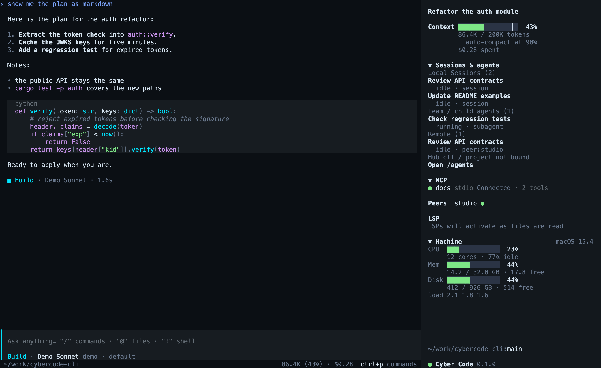
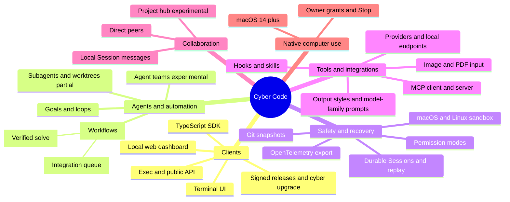

# Cyber Code (`cyber`)

A model-independent coding agent with a terminal UI, local web dashboard and durable background server. Run one task, coordinate agents, or compare patches with a verified workflow—all against the same local Sessions.

**Development status:** the local core and first web dashboard are implemented. Broader platform, integration and release acceptance is still in progress; see [Known gaps](#known-gaps).

Coding-quality evidence: [GPT-6.1 Sol / ChatGPT pilot](docs/measurements/gpt61-sol-chatgpt-pilot.md), with measured outcomes and comparison limits; [stream reliability fixes and follow-up](docs/measurements/provider-stream-reliability-follow-up.md).

[Real-repository and solve pilot](docs/measurements/real-repository-evaluation.md): original outcomes and separate follow-ups, with setup issues and comparison limits.

## Quickstart

Requires **Rust 1.89+**; SQLite is bundled. On Linux, install **bubblewrap** for sandboxed commands (`sudo apt install bubblewrap`).

```bash
cargo build --locked -p cyber-cli
export OPENAI_API_KEY="your-key"
./target/debug/cyber
```

OpenAI, Anthropic, GitHub Copilot and OpenAI-compatible endpoints are supported, including local model servers. Instead of an API key, you can sign in with a subscription:

| Subscription | Sign in | Guide |
|---|---|---|
| ChatGPT Plus/Pro | `cyber providers login chatgpt`, or `/login` in the TUI | [ChatGPT sign-in](docs/local-core-guide.md#signing-in-with-a-chatgpt-subscription) |
| GitHub Copilot | `cyber providers login copilot` (CLI only) | [Copilot sign-in and limits](docs/local-core-guide.md#signing-in-with-a-github-copilot-subscription) |
| Google Gemini | Not supported: third-party use of Gemini subscriptions has led to account suspensions, so `/login google` is refused | — |

There is no native Gemini adapter yet (planned), so `GEMINI_API_KEY` alone does not enable Gemini models. Use them through a Copilot plan that serves them, or through an OpenAI-compatible gateway.

Examples below use the built binary. If you installed it on your PATH, use `cyber` instead of `./target/debug/cyber`.

## Install a release

Tagged releases publish signed archives for macOS, Linux (glibc and musl) and Windows (preview) to [GitHub Releases](https://github.com/CyberdyneCorp/cybercode-cli/releases). The install script checks each archive's SHA-256 (and its Sigstore signature when `cosign` is installed); `cyber upgrade` always verifies both before replacing the binary.

```bash
curl -fsSL https://github.com/CyberdyneCorp/cybercode-cli/releases/latest/download/install.sh | sh
cyber upgrade                # verified in-place upgrade
cyber uninstall --dry-run    # what uninstall would remove
```

Package-manager manifests (Homebrew, npm, Scoop, WinGet, AUR, Nix) are rendered for each release but not published yet. See [install, upgrade and uninstall](docs/local-core-guide.md#install-upgrade-and-uninstall).

## Run the web dashboard

```bash
./target/debug/cyber service password  # copy the printed login password
./target/debug/cyber web               # start/reuse the server and open your browser
```

Enter the password on the login page. The dashboard shares Sessions with the terminal: read transcripts, send prompts, review held agent messages, approve permissions, answer questions, and monitor or control Workflows, Jobs and Goals.

To open it manually, follow the URL printed by:

```bash
./target/debug/cyber web --no-open
```

The password grants **owner access** and stays in page memory. Off-loopback access requires HTTPS; a user-managed SSH forward is also supported. See the [dashboard guide](docs/web-dashboard.md) for remote setup, disconnect behavior and desktop/mobile screenshots. Full Settings, general attachment previews and terminal emulation remain unfinished.

## Common commands

```bash
./target/debug/cyber exec "fix the failing test"    # one task
./target/debug/cyber review main..HEAD             # read-only code review
./target/debug/cyber --continue                    # resume the latest Session
./target/debug/cyber exec --file shot.png "explain this screenshot"
./target/debug/cyber workflows list                # bundled and saved Workflows
./target/debug/cyber workflows run audit --wait    # run a bundled audit
./target/debug/cyber service status                # inspect the shared server
./target/debug/cyber computer status               # inspect native support and OS consent
./target/debug/cyber doctor                        # check your setup
./target/debug/cyber upgrade                       # verified upgrade of an installed release
```

The server owns execution and stores state in SQLite, so work can outlive a terminal window. After a crash, Sessions recover interrupted state and Workflows can replay; see [server lifecycle and recovery](docs/local-core-guide.md#background-server-and-rebuilds).

For independent patch attempts, host-recorded tests and a separate read-only judge, start with the [verified `solve` workflow](docs/verified-workflows.md). Candidate patches remain available for human review; nothing is merged automatically. To combine complementary commits, use the [verified integration queue](docs/verified-integrations.md): submit a dependency manifest, test the combined patch, review independent advice, then explicitly publish a branch and PR.

Experimental [PR auto-fix subscriptions](docs/pr-autofix.md) provide bounded CI/review monitoring, isolated verified fixes and safe pushes on a running self-hosted server. [Local and macOS acceptance](docs/implementation/pr-autofix.md) passed; live GitHub acceptance, cloud failover and fork writes remain pending. Strict mode currently requires the official OpenAI Responses adapter.

Experimental [native computer use](docs/computer-use.md) adds macOS 14+ application/display screenshots and input with expiring owner grants, CLI/browser owner controls, private evidence and emergency Stop. Off by default; controlled macOS capture, input and Stop acceptance passed. Other layouts and signed distribution remain release checks.

## Sessions and people working together

Cyber supports communication between Sessions and between different people's agents working on the same Git project.

The TUI sidebar previews named local Sessions, team/child agents and remote Sessions with status and source labels. Open `/agents` for the full directory and its message, watch and rename actions.



*Actual TUI capture with isolated demo data. See the [screenshot gallery and capture instructions](docs/screenshots/README.md).*

- **On one server:** Sessions and agents can discover, message and watch each other. See [Session messaging](docs/local-core-guide.md#cross-session-messaging).
- **Across your machines:** [direct peers](docs/peers.md) connect Sessions without an account or relay.
- **With teammates or friends:** a [self-hosted project hub](docs/collaboration.md) connects verified members and their explicitly published agents, with conversations and shared tasks. Each person binds their own checkout to the project; tools, working trees and execution approvals stay local. Incoming agent messages are held for receiver consent by default. The hub is **experimental and off by default**.

```bash
# One server: message another Session by title or ses_ ID (agents use the send_message tool)
./target/debug/cyber messages list --reachable
./target/debug/cyber messages send "API refactor" "main changed; rebase and rerun the tests"

# Two of your machines: pair once, then address Sessions as <session>@<machine>
desk$   cyber peers invite laptop               # prints a one-time cyberpeer:// code
laptop$ cyber peers add desk '<code>'
laptop$ cyber messages send --from reviewer "API refactor@desk" "review is ready"   # held on desk until released

# Different people and accounts: bind each checkout to a hub project, then publish an agent
cyber features enable collaboration && cyber login
cyber collab bind --hub https://hub.example.com --project cprj_PROJECT --confirm
cyber collab publish --project cprj_PROJECT --session ses_SESSION --name reviewer   # then /collab in the TUI
```

Messages always arrive as untrusted text, never as instructions or approvals.

## Feature mindmap

This is a map of available capabilities, including partial and experimental areas. The [feature reference](docs/features.md) records their limits and acceptance status.



## Known gaps

Cyber Code has working features in each area below, but it is not at full feature parity with every alternative. Checked **2026-10-24** against official documentation; this compares capabilities, not coding quality or benchmark performance. Related desktop, IDE and hosted products are distinguished from each terminal CLI.

| Compared with | What their documentation provides | What remains in Cyber Code |
|---|---|---|
| **OpenCode** | A broad [provider catalog](https://opencode.ai/docs/providers/), [IDE integration](https://opencode.ai/docs/ide/) and [web UI](https://opencode.ai/docs/web/). | Native provider coverage is narrower; dedicated IDE/desktop clients are planned. The web dashboard is implemented, but full TUI-equivalent browser controls remain unfinished. |
| **Claude Code CLI** | The CLI is part of a [terminal/IDE/desktop/web offering](https://code.claude.com/docs/en/overview), with [plugin marketplaces](https://code.claude.com/docs/en/discover-plugins). | IDE/desktop clients, plugin marketplaces and complete cross-tool configuration/plugin compatibility remain unfinished. A plugin host, SDK, skills and hooks already exist. |
| **Codex CLI** | A [terminal coding agent](https://learn.chatgpt.com/docs/codex/cli), related IDE/cloud surfaces, and a [native Windows sandbox](https://learn.chatgpt.com/docs/windows/windows-sandbox). | Windows confinement remains partial. Dedicated editor/desktop clients, hosted runners and paired-device Relay access are planned. Private HTTPS/SSH dashboard access already works. |
| **Pi** | A deliberately small [terminal harness with TypeScript extensions, packages and an SDK](https://github.com/earendil-works/pi/tree/main/packages/coding-agent). | Cyber ships its own plugin host and SDK; package marketplaces and broader extension compatibility remain unfinished. Pi intentionally leaves features such as subagents and plan mode to extensions/packages, so its smaller core is a design choice. |

Other limits to consider:

- **Acceptance is ongoing:** the full local-model baseline, Windows enforcement and several P1 migration, memory and code-intelligence paths remain open.
- **Automation has edges:** [reserved budgets](docs/reserved-budgets.md) currently support bounded official OpenAI Responses requests; subscriptions use soft token/time controls. Finished-agent transcript retention and persistent scheduling are separate roadmap items; agent teams and the project hub are experimental.
- **Native computer use is experimental:** macOS 14+ only, off by default; controlled capture, input and Stop passed. Other layouts, live OS revocation and release signing remain unverified.
- **Remote access is private:** physical-device certificate trust is an operator check. Relay, paired Devices and mobile apps remain roadmap work.

Use the [feature reference](docs/features.md), [P1 evidence](docs/implementation/p1-status.md), [P2 evidence](docs/implementation/p2-status.md) and [roadmap](ROADMAP.md) for exact scope. A planned OpenSpec requirement is not proof of implementation.

## Architecture

The TUI, web dashboard, CLI, SDK and MCP clients call one server. That server enforces permissions, schedules agents, streams events and owns durable state. See the [architecture diagrams](docs/architecture.md) and [storage decision](docs/decisions/0001-storage-architecture.md).

## Guides and development

| I want to… | Read |
|---|---|
| Configure providers, permissions, MCP or Sessions | [Local core guide](docs/local-core-guide.md) |
| Send traces, metrics and logs to my OpenTelemetry collector | [OpenTelemetry export](docs/local-core-guide.md#opentelemetry-export) · `cyber telemetry show` |
| Use the browser dashboard and remote approvals | [Dashboard guide](docs/web-dashboard.md) |
| Enable native screenshots and input | [Native computer use](docs/computer-use.md) |
| Run agents across machines or a group project | [Direct peers](docs/peers.md) · [Project hub](docs/collaboration.md) |
| Build or customize a workflow | [Workflow guide](docs/local-core-guide.md#workflows-p2-m21) · [Verified solve](docs/verified-workflows.md) · [Integration queue](docs/verified-integrations.md) |
| See the interface | [Screenshots](docs/screenshots/README.md) · [Dashboard screenshots](docs/web-dashboard.md#browser-views) |
| Integrate another program | [TypeScript SDK](sdk/typescript/README.md) · [Plugin SDK](sdk/plugin/README.md) · [OpenAPI](sdk/openapi.json) |
| Find a command or planned capability | [CLI reference](docs/cli.md) · [Roadmap](ROADMAP.md) · [OpenSpec](openspec/specs) |
| Check builds, tests or evaluations | [Development guide](docs/local-core-guide.md#build-and-development) · [Evaluation guide](eval/README.md) |

Run `just` for available development tasks and `just ci` for local checks. Browse the [documentation index](docs/README.md) for the full guide set.
