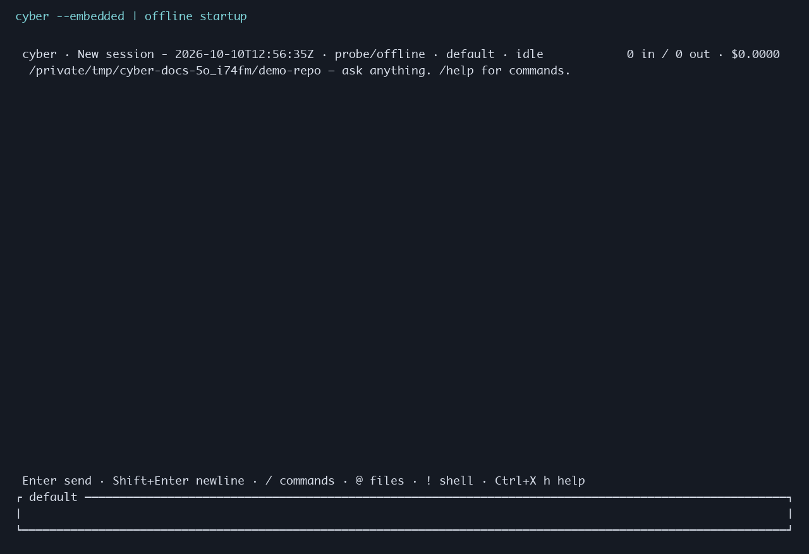
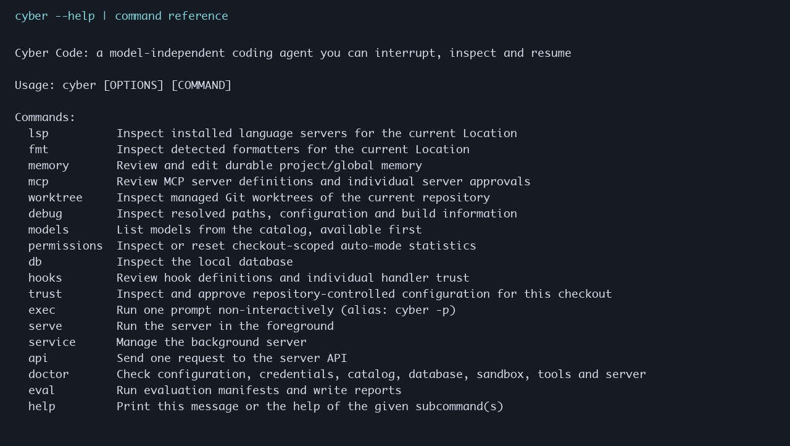
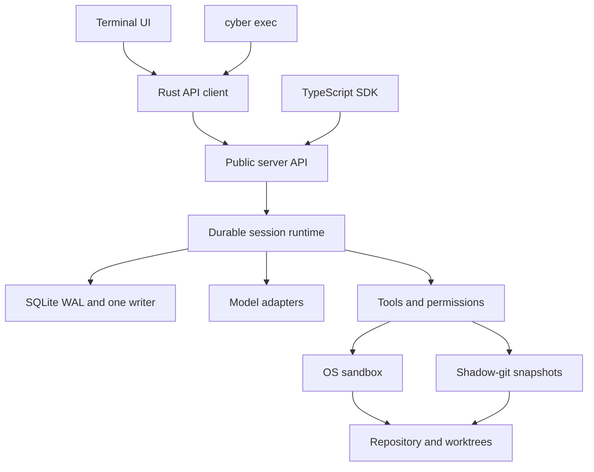
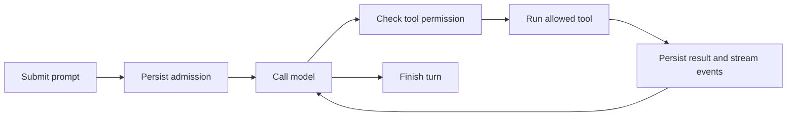

# Cyber Code (`cyber`)

A model-independent coding agent with durable local sessions, repository tools and a terminal UI.

Inspect code, edit files, run tests and resume interrupted work. Sessions stay on your machine in SQLite. Use OpenAI, Anthropic or an OpenAI-compatible endpoint, including a local model server. No Cyber account is required; hosted models require provider credentials.



Actual TUI capture, with no model inference. [Screenshots and reproduction](docs/screenshots/README.md).

<details>
<summary>See the CLI command reference</summary>



</details>

## Start here

Requires **Rust 1.89+**. SQLite is bundled. On Linux, install **bubblewrap** for sandboxed commands (`apt install bubblewrap`).

```bash
cargo build --locked -p cyber-cli
export OPENAI_API_KEY="your-key"

./target/debug/cyber                            # terminal UI
./target/debug/cyber exec "fix the failing test" # one task
./target/debug/cyber review main..HEAD            # read-only review with sorted findings
./target/debug/cyber --continue                 # resume the latest session
./target/debug/cyber doctor                     # check your setup
```

Use `--model provider/model` to select a model. See the [local core guide](docs/local-core-guide.md) for configuration and [evaluation guide](eval/README.md) for local-model setup.

Remote MCP servers that require OAuth are signed in explicitly. `cyber` never opens a browser or starts a sign-in on its own; a refused server reports `needs_auth`:

```bash
./target/debug/cyber mcp auth github   # prints the authorization URL, waits for the 127.0.0.1 callback
./target/debug/cyber mcp logout github # forgets the stored tokens
```

See [remote MCP OAuth](docs/local-core-guide.md#remote-mcp-oauth) for the `oauth` settings and token storage.

MCP servers that advertise resources or prompts add three surfaces. Server content is always wrapped as untrusted data, never as instructions:

- Resource tools: the model can call `mcp_list_resources`, `mcp_list_resource_templates` and `mcp_read_resource`. These tools are read-only (also offered in plan mode), checked as `read` on `mcp:<server>:<uri>` and capped at 512 KiB per read.
- `@<server>:<uri>` in a prompt, for example `@docs:file:///guide.md`, attaches that resource. If it cannot be attached, a visible `[resource not attached: ...]` notice appears instead.
- `/<server>:<prompt> [args]` runs a server prompt as a slash command, checked as `mcp_prompt` on `mcp:<server>:<prompt>`.

See [MCP resources](docs/local-core-guide.md#mcp-resources) and [MCP prompts as commands](docs/local-core-guide.md#mcp-prompts-as-commands).

During a tool call, a local or remote server can ask you a question through [form elicitation](docs/local-core-guide.md#mcp-form-elicitation). You answer Accept, Decline or Cancel; `cyber exec` and other unattended runs decline, and Cyber Code never opens a link for a server. Local servers see the Location and writable roots as [MCP roots](docs/local-core-guide.md#mcp-workspace-roots), and a sandbox change restarts them with the new roots.

Other agents can drive Cyber Code over MCP. `cyber mcp serve` is a stdio MCP server bridged to the local Cyber server, so the Sessions it creates show up in the TUI like any other:

```bash
claude mcp add cyber -- cyber mcp serve --client claude-code   # Claude Code
./target/debug/cyber mcp serve --transport http                  # prints the loopback endpoint for HTTP clients
```

The calling agent creates and reads Sessions, sends prompts (`cyber_prompt`, with a wait or a receipt) and interrupts runs. Approvals stay with a human in a Cyber client, and new Sessions are bounded by a Mode ceiling and limits from the global configuration. See [MCP serve](docs/local-core-guide.md#mcp-serve-partial-p1) for Codex and HTTP setup, the trust model and the limits.

## What it does

| Area | Current behavior |
|---|---|
| Coding | Read/search repositories, edit files and notebook cells, run commands and use web tools |
| Sessions | Durable prompt admission, streaming, interrupt/resume, crash recovery and compaction |
| Safety | Checkout trust, tool permissions, protected paths, credential masking and macOS/Linux sandboxing |
| Recovery | Shadow-git snapshots, restore preserving user edits, database-plus-artifact backup and retention |
| Skills | Bundled `/review`, `/batch`, `/simplify`, `/security-review` and `/customize-cyber`; replaceable templates and forked reviewer tasks; `cyber review [target]` and TUI `/review` resolve uncommitted changes, ranges, commits or `pr <number>` and report validated findings most severe first; remote `https://` skill sources cached for offline use. Partial: real-model review quality, plugin skills and native acceptance |
| Clients | TUI, `exec`, background service, public API and generated TypeScript SDK |
| TUI | Themes (18 built-in, custom JSON, `NO_COLOR`), Markdown with highlighted code, a status footer and per-run marker, the `Ctrl+P` palette, a responsive sidebar (context, MCP, LSP, modified files, branch), a file explorer, and a Settings panel with Status, Config, Usage and a Stats heatmap with a book comparison line (also `cyber stats`); the Nyan progress indicator; Session recaps after time away. Partial: some Settings extras |
| MCP client | Local (stdio) and remote (Streamable HTTP, legacy SSE) servers with OAuth sign-in, resource tools, `@server:uri` mentions, `/<server>:<prompt>` commands, form elicitation (declined when unattended, never opens links), workspace roots with reconnect on sandbox change, opt-in sampling (local servers), `list_changed` refresh and cancellation notices. Partial: native Windows acceptance; WebSocket is not implemented |
| MCP serve | `cyber mcp serve` (stdio bridge, or loopback Streamable HTTP) lets other agents create, read, prompt and interrupt Sessions, with receipts, waits with progress, idempotent retries, a Mode ceiling and limits. Nested calls through Sessions are bounded by a recursion guard. Partial: messaging tools, usage attribution and unattended approval handling |
| Hooks | Command, HTTP, prompt and MCP-tool handlers on tool and lifecycle events, with exact handler trust, managed-only org policy, async handlers and durable receipts. Partial: plugin hooks, sandboxed hook scopes on Windows and events without a producer |
| Workflows (P2 M2.1) | JavaScript Workflows in a QuickJS sandbox fan out real child-Session agents with `agent()`, `parallel()` and `pipeline()`; `cyber workflows run <name\|file> --wait` (exit 0/1/4/130), `runs`, `show`, `pause`, `resume`, `stop` and `logs`; the model's `workflow` tool behind the `workflow.run` permission; durable replay across restarts, run budgets, model tiers, worktree isolation for concurrent writers, one queued summary per run (summaries that end together share one Turn), the TUI's `/workflows` monitor with sidebar, footer and progress-line indicators and run-end notices, and the SDK's `client.workflows.run()`, `list()` and `get()`. Several runs at once: up to `workflows.max_running_runs` execute (the rest queue and are dispatched oldest first), their agents share the `workflows.max_concurrent` slots fairly (least recently granted run first) with an optional per-run `max_concurrent` share, each run pauses, stops and resumes on its own, a restart pauses interrupted runs for `cyber workflows resume --interrupted` (or `resume_after_restart`), and `cyber workflows runs --watch` follows live counts. Verified end to end with the real binary against a scripted local provider (fan-out under the concurrency cap, HTTP background runs, determinism guards, resume after `kill -9`, budget exit 4, stop, permission and Mode ceilings; for parallel runs: three runs from the CLI, HTTP and the `workflow` tool with fair grants, the run queue, independent pause/stop/resume, `kill -9` with two runs mid-flight and one queued, `runs --watch`, and the TUI monitor in a pty). The parallel-runs acceptance (`add-parallel-workflow-runs` section 11) is also automated: `cyber-cli` `parallel_workflows` drives the real binary and server (fair grants, independent control, `kill -9` recovery) and `cyber-tui` `screens_parallel` drives the monitor through `TestBackend`. Not yet: `ask()`, direct read-only `tools`, prompt-cache warm-up, `exec --workflow`, Job/`/tasks` integration, saved-Workflow listing over HTTP |
| Project instructions | `AGENTS.md` (shared with other agents), `CLAUDE.md` (Claude Code compatibility, only where a directory has no `AGENTS.md`), `CONTEXT.md` and `CYBER.md` (Cyber Code's own file), loaded from the global config directory and from each directory between the project root and the Location; `@path` imports (depth 5); project files and their imports confined to the project, regular files only, bounded reads, `AGENTS.override.md`, truncation at 32 KiB, `CYBER_DISABLE_CLAUDE_MD` and `CYBER_DISABLE_PROJECT_CONFIG`, nested files attached on `read` once per Context Epoch, and a `cyber doctor` `instructions` check. Not yet: `.cyber/rules`, `.claude/CLAUDE.md`, the `~/.claude/CLAUDE.md` fallback and a configurable `instructions.max_bytes` |
| Partial P1 | Subagents/worktrees, cancellation controls, usage/budgets, memory, LSP navigation and edit feedback, automatic formatting, migration detection and read-only previews |

**P0 is implemented, with release gates still open:** the full local-model baseline, including the long coding task, remains incomplete. **P1 is in progress; no P1 milestone is fully accepted.** Windows confinement, native MCP OAuth keyring acceptance, plugins, complete client controls, browser verification and migration still need work or acceptance. Later phases cover goals, remote control, cloud runners and IDE clients (editor integration moved to P3); the P2 Workflow runtime (M2.1) is implemented and accepted end to end, except `ask()`, direct read-only tools, `exec --workflow` and Job integration ([P2 evidence](docs/implementation/p2-status.md)). `CYBER.md`, Cyber Code's own instruction file, loads next to `AGENTS.md`, `CLAUDE.md` and `CONTEXT.md` ([how to write one](docs/local-core-guide.md#project-instructions-and-cybermd)).

See the [complete feature reference](docs/features.md), [P0 evidence](docs/measurements/p0-exit-evidence.md), [P1 status](docs/implementation/p1-status.md) and [roadmap](ROADMAP.md).

## Architecture



The server owns execution, compaction and recovery. Clients use HTTP, SSE, WebSocket or stdio JSON-RPC. SQLite stores execution state; snapshots store file recovery data. Built with Rust, tokio, axum, rusqlite and ratatui. [Architecture details](docs/local-core-guide.md#architecture).



## How it compares

Scope: **Cyber Code, Claude Code, Codex and OpenCode coding tools**, checked **2026-10-10**. This compares documented capabilities, not coding quality or speed. Partial means our implementation has working pieces and remaining contracts or acceptance gates.

| Feature | Cyber Code | Claude Code | Codex | OpenCode |
|---|---|---|---|---|
| Edit files and run commands | Yes | Yes [docs][C1] | Yes [docs][X1] | Yes [docs][O1] |
| Model providers | OpenAI, Anthropic, compatible endpoints | Claude through supported providers [docs][C1] | OpenAI and custom providers [docs][X2] | Multiple providers [docs][O2] |
| Local models | Compatible adapter; full baseline pending | Not established by cited docs | Ollama / LM Studio [docs][X2] | Ollama / LM Studio [docs][O2] |
| Terminal and automation | TUI and `exec` | CLI and SDK [docs][C1] | CLI and `exec` [docs][X1] | TUI and CLI [docs][O1] |
| Editor / desktop / web clients | IDE clients (ACP, VS Code) planned for P3; local web UI P1, desktop app P4 | Available [docs][C1] | IDE and cloud surfaces [docs][X1] | Desktop and IDE [docs][O1] |
| Tool permissions | Yes; full auto mode partial | Yes [docs][C2] | Yes [docs][X3] | Yes [docs][O3] |
| OS sandbox | macOS/Linux; Windows incomplete | macOS/Linux/WSL2; native Windows unsandboxed [docs][C2] | Documented sandbox controls [docs][X3] | Permission rules documented [docs][O3]; OS isolation not established here |
| Subagents | Partial P1 | Yes [docs][C3] | Yes [docs][X1] | Yes [docs][O4] |
| MCP integration | Client for local (stdio) and remote (Streamable HTTP, SSE) servers: OAuth via `cyber mcp auth` (OS keyring; 0600 file on Linux), resources, `@server:uri` mentions, prompt commands, form elicitation, roots, opt-in local sampling, `list_changed` refresh and cancellation. `cyber mcp serve` for other agents (partial). Partial: WebSocket, native Windows acceptance | Local and remote [docs][C4] | stdio and HTTP [docs][X2] | Local and remote [docs][O5] |
| File undo / recovery | Snapshots preserving user edits | Edit checkpoints and rewind [docs][C5] | Git checkpoints recommended [docs][X1] | Undo/redo [docs][O1] |
| Programmatic server | HTTP/events, stdio API, TS SDK | Agent SDK [docs][C1] | App Server [docs][X4] | HTTP/OpenAPI and SDK [docs][O6] |
| LSP integration | Navigation/feedback partial P1 | Language-server plugins [docs][C6] | Not established by cited docs | Built-in LSP support [docs][O7] |

“Not established” means the linked sources do not establish support; it does not mean the feature is absent. These products have different defaults, platform limits and release channels. Cyber's [feature reference](docs/features.md) records our implementation limits.

## Documentation and development

[Documentation index](docs/README.md) · [Commands and configuration](docs/local-core-guide.md) · [Roadmap](ROADMAP.md) · [SDK](sdk/typescript/README.md) · [OpenAPI](sdk/openapi.json) · [Evaluations](eval/README.md) · [OpenSpec contracts](openspec/specs)

Run `just` to list tasks, `just build` to build and `just ci` for local checks. Platform builds run in [CI](.github/workflows/ci.yml). See the [development guide](docs/local-core-guide.md#build-and-development) for raw commands and the pinned specification validator.

[C1]: https://code.claude.com/docs/en/overview
[C2]: https://code.claude.com/docs/en/sandboxing
[C3]: https://code.claude.com/docs/en/sub-agents
[C4]: https://code.claude.com/docs/en/mcp
[C5]: https://code.claude.com/docs/en/checkpointing
[C6]: https://code.claude.com/docs/en/discover-plugins
[X1]: https://learn.chatgpt.com/docs/codex/cli
[X2]: https://learn.chatgpt.com/docs/config-file/config-reference
[X3]: https://learn.chatgpt.com/docs/security
[X4]: https://learn.chatgpt.com/docs/app-server
[O1]: https://opencode.ai/docs/
[O2]: https://opencode.ai/docs/providers/
[O3]: https://opencode.ai/docs/permissions/
[O4]: https://opencode.ai/docs/agents/
[O5]: https://opencode.ai/docs/mcp-servers/
[O6]: https://opencode.ai/docs/server/
[O7]: https://opencode.ai/docs/lsp/
