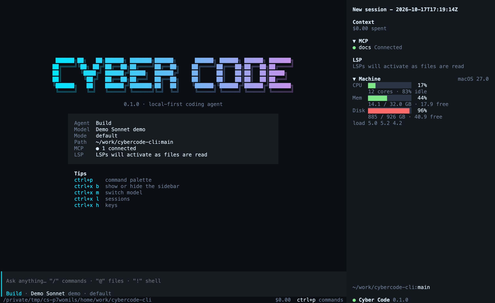
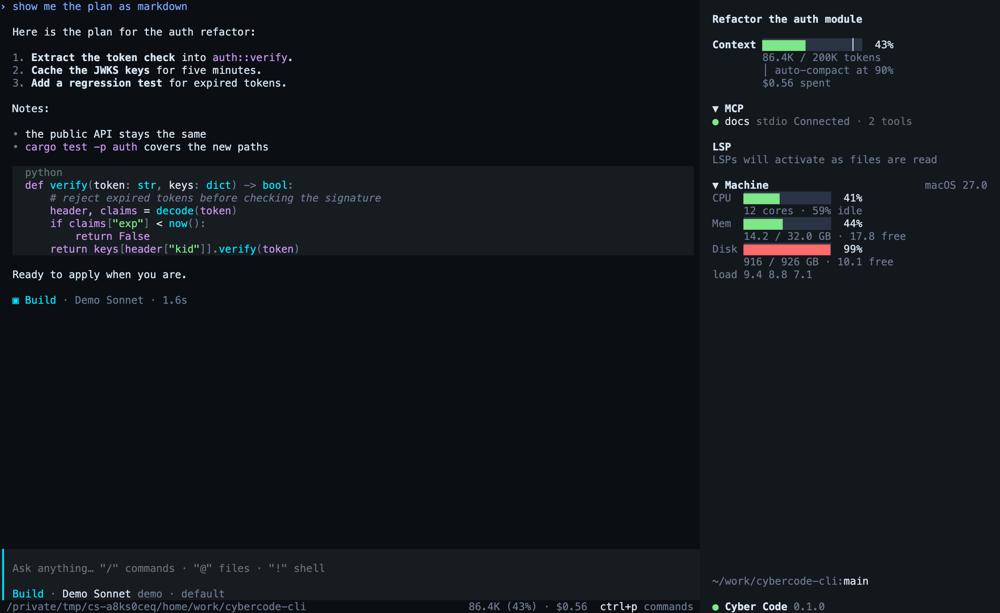
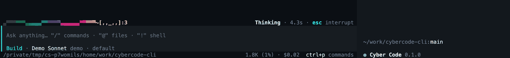
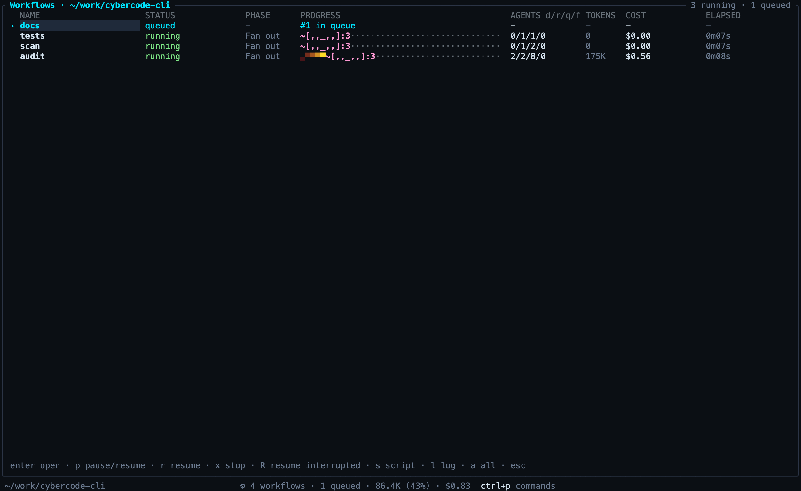
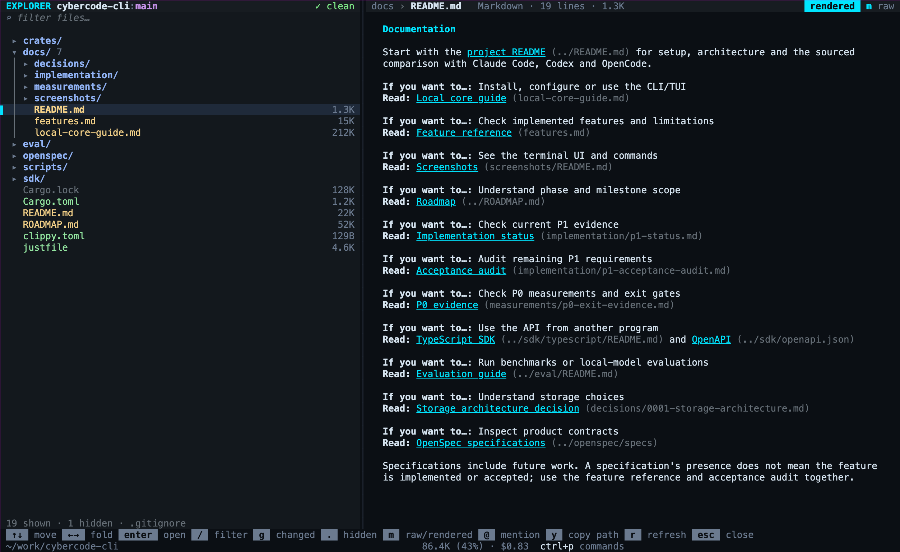
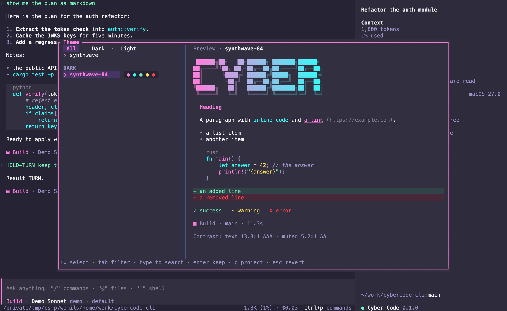
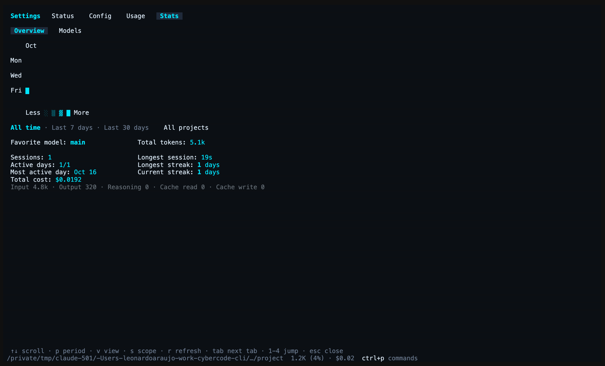
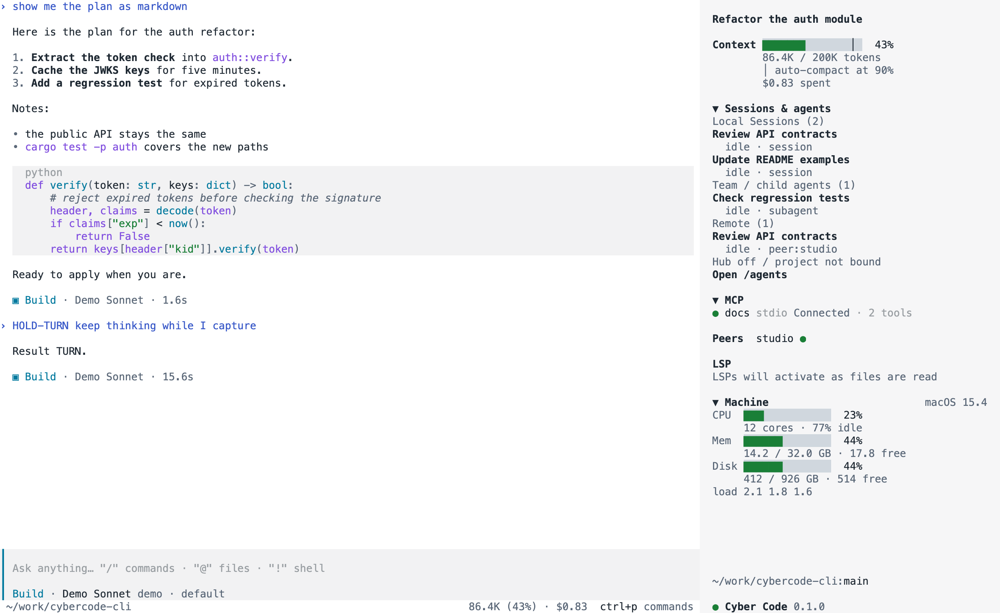
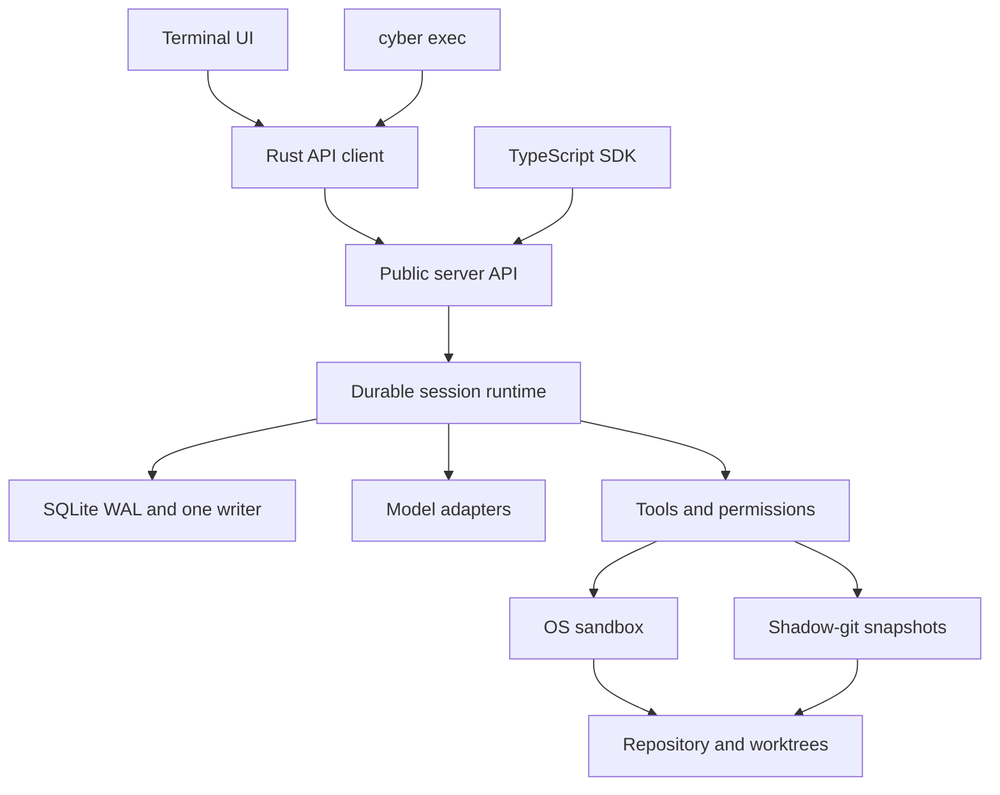
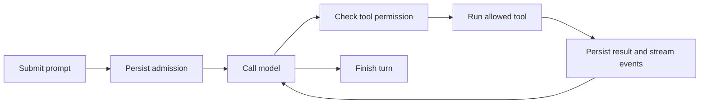

# Cyber Code (`cyber`)

A model-independent, local-first coding agent: a durable server owns your sessions and multi-agent workflows, and a terminal UI, `exec`, an SDK or another agent over MCP can drive it.

## Why Cyber Code

- **Any model, no account.** OpenAI, Anthropic or any OpenAI-compatible endpoint, including a local model server. No Cyber account; hosted models need their own provider credentials. A ChatGPT Plus/Pro plan can pay for OpenAI models instead of an API key (`cyber providers login chatgpt`), and a GitHub Copilot plan for the OpenAI, Anthropic and Google models it serves (`cyber providers login copilot`). The full local-model baseline is still open ([evaluation guide](eval/README.md)).
- **A server that survives a crash.** Prompts are persisted before they run, and execution state lives in SQLite. A restarted server recovers interrupted Sessions, and the TUI, SDK and MCP clients share the same Sessions.
- **Workflows that resume after `kill -9`.** Claude Code also has [script-driven workflows][C7] with `agent()`/`parallel()`/`pipeline()`. Cyber's differences: runs execute in the background server rather than inside a CLI process; after a server crash they replay durably (`cyber workflows resume --interrupted`); several runs share agent slots fairly with a run queue; and each run has budgets and model tiers that can point at any provider ([details](docs/local-core-guide.md#workflows-p2-m21)). Five verified Workflows ship built in, `review`, `audit`, `migrate`, `research` and `plan`, and `/review` runs the first ([bundled Workflows](docs/local-core-guide.md#bundled-workflows-p2-m22)).
- **Other agents can drive whole Sessions.** `cyber mcp serve` lets Claude Code, Codex or another MCP client create, prompt, wait on and interrupt Cyber Sessions, with idempotent receipts and a Mode ceiling. All 10 tools ship, including listing, sending and reading cross-session messages. `claude mcp serve` [exposes Claude Code's tools][C4], and Codex [removed its MCP server][X5]. Partial: unattended approval rules and the recursion-depth markers for hook and PTY processes remain.
- **Recovery and confinement.** Shadow-git snapshots restore files without overwriting your own edits. Commands run in an OS sandbox on macOS and Linux (Windows is incomplete).
- **Open contracts.** Behavior is specified as [OpenSpec requirements](openspec/specs) tagged by phase and validated in CI, and implementation evidence is published ([P1](docs/implementation/p1-status.md), [P2](docs/implementation/p2-status.md)).
- **Many agents, one server.** Subagents run as real child Sessions (in the background or in their own worktree), workflows fan out dozens of agents with fair scheduling across runs, and every agent's transcript stays inspectable. Sessions talk to each other on one server ([how](#sessions-talking-to-each-other)) and across your own machines over direct peers ([how](#messaging-across-machines)). Agent teams are available behind the experimental `teams` feature (off by default; `cyber features enable teams`): a lead can spawn teammates (each in its own worktree, bounded by the lead's permissions) who share a task board with dependencies and atomic claims, message each other by name (`lead`, `all`, teammate names) and report to the lead when they go idle; teammates sharing the lead's checkout cannot edit each other's owned paths, and the lead merges worktree teammates' branches with `team_merge`, which lists conflicts without touching its checkout; a team budget stops teammates (the lead gets the spend per member), and a stopped team resumes with its Sessions, board and messages intact; `cyber teams list|show|stop|resume` and the `/api/v1/teams` routes show each member's status, current task, cost and last message with the task board, and the TUI's `/team` view shows the members and board live, opens a teammate to instruct it directly and labels teammates' approval requests (`[tests] Allow bash: …?`) and idle notices in the lead's TUI. Teams were accepted by hand on the real binary ([evidence](docs/implementation/p2-status.md#agent-teams-2026-10-20)); distributed teammates (P3) and teammate panes (P4) are not built.
- **A full terminal UI.** 18 themes with a live switcher, Markdown with highlighted code, a responsive sidebar with a context-window bar (tokens used, auto-compact point, cost), the MCP servers and machine stats (CPU, memory, disk), the `Ctrl+P` palette, a file explorer, a workflows monitor, Usage/Stats tabs (also as `cyber stats`), and `/rename` to name a Session and resume it later by title.

## Screenshots

Real captures of the TUI in a 160×48 pseudo-terminal against a scripted local model (not live inference); the Machine bars are live readings of the capturing machine. Regenerate them with `just screenshots` ([how](docs/screenshots/README.md)).

| Welcome screen with the sidebar | Transcript: Markdown, highlighted code, turn marker |
|---|---|
|  |  |
| **Thinking: the Nyan progress indicator** | **`/workflows`: three runs and one queued** |
|  |  |
| **File explorer with a rendered Markdown preview** | **`/theme` switcher with live preview** |
|  |  |
| **Settings › Stats** | **Light theme** |
|  |  |

More: [Settings › Usage](docs/screenshots/usage.png), [the `/rename` dialog](docs/screenshots/rename.png) and [a Turn in progress](docs/screenshots/thinking.png).

## Start here

Requires **Rust 1.89+**. SQLite is bundled. On Linux, install **bubblewrap** for sandboxed commands (`apt install bubblewrap`).

```bash
cargo build --locked -p cyber-cli
export OPENAI_API_KEY="your-key"                  # or use your ChatGPT or Copilot plan, below

./target/debug/cyber                              # terminal UI
./target/debug/cyber exec "fix the failing test"  # one task
./target/debug/cyber review main..HEAD            # read-only review with sorted findings
./target/debug/cyber --continue                   # resume the latest session
./target/debug/cyber -r "auth refactor"           # resume a Session by title (name it with /rename)
./target/debug/cyber sessions list                # list, show, rename, delete or export Sessions
./target/debug/cyber workflows list                # list saved and bundled Workflows; create one using the guide below
./target/debug/cyber workflows run audit --wait   # run a bundled one: review, audit, migrate, research, plan
./target/debug/cyber stats --models               # local usage stats
./target/debug/cyber doctor                       # check your setup
```

### Use your ChatGPT subscription

A ChatGPT Plus or Pro plan can pay for OpenAI models instead of an API key, in the same way as Codex, OpenCode or Pi:

```bash
./target/debug/cyber providers login chatgpt                # prints a URL; the browser returns to localhost:1455
./target/debug/cyber providers login chatgpt --method code  # over SSH: paste the URL the browser ends on
./target/debug/cyber models chatgpt                         # the models your plan serves, e.g. chatgpt/gpt-6-sol
./target/debug/cyber exec -m chatgpt/gpt-6-sol "fix the failing test"
./target/debug/cyber providers logout chatgpt
```

In the TUI, `/login openai` signs in from a dialog. It shows the URL to open, or takes the redirect URL you paste. The plan's models are usable at once, without restarting the server. `/logout openai` signs out. Google (Gemini) subscription logins are not supported.

Usage counts against your plan's limits. The login is kept in `~/.local/share/cyber/chatgpt-auth.json` (mode 0600), separate from Codex's, and the token is renewed before it expires. The model list comes from your account and is refreshed daily. macOS and Linux only for now. Details: [ChatGPT subscription](docs/local-core-guide.md#signing-in-with-a-chatgpt-subscription).

### Use your GitHub Copilot subscription

A Copilot Pro, Pro+, Business or Enterprise plan can pay for the OpenAI, Anthropic and Google models it serves. GitHub supports Copilot plans in third-party agents. The sign-in is GitHub's device flow, so it works over SSH too:

```bash
./target/debug/cyber providers login copilot                              # prints a URL and a code to enter there
./target/debug/cyber providers login copilot --enterprise octo.ghe.com    # a GitHub Enterprise (data residency) host
./target/debug/cyber models copilot                                       # the models your plan serves, e.g. copilot/claude-sonnet-4.5
./target/debug/cyber exec -m copilot/claude-sonnet-4.5 "fix the failing test"
./target/debug/cyber providers logout copilot
```

Each prompt counts as one premium request: the tool-loop steps after it, hook checks, page summaries, subagents, background handbacks, compaction and titles are sent as the agent's, as in Copilot's own agent mode. The GitHub login is kept in `~/.local/share/cyber/copilot-auth.json` (mode 0600). The short-lived Copilot token is minted from it, kept in memory only and renewed before it expires. The model list comes from your account and is refreshed daily. macOS and Linux only for now. Not yet checked against a live Copilot account: it is tested against a local fake GitHub, and the OAuth client ID is provisional. Details: [GitHub Copilot subscription](docs/local-core-guide.md#signing-in-with-a-github-copilot-subscription).

### Permission modes

Every Session runs in one Mode. Pick it with `--mode`, the `mode` config key or `/mode <name>`; Shift+Tab in the TUI cycles `default → accept-edits → plan → auto`.

| Mode | What it does |
|---|---|
| `default` | Reads in the Location run; edits, commands and anything else not allowed by a rule ask you. |
| `accept-edits` | File edits and simple file commands (`mkdir`, `touch`, `mv`, `cp`, non-recursive `rm`) inside the Location run without asking; everything else still asks. |
| `plan` | Read-only. The agent writes a plan and presents it with `plan_exit`; approving it switches to the Mode you choose. |
| `auto` | Each action that would ask goes to a classifier model, which allows or blocks it with a reason. Three blocks in a row, or no classifier, fall back to asking. |
| `dont-ask` | Anything that would ask is denied and the agent carries on. The default for `cyber exec`. |
| `bypass` | Everything runs without asking, except your explicit deny rules, protected paths, critical removals and organization policy. |

To run without prompts:

```bash
cyber --mode bypass                                   # TUI, or `/mode bypass` (asks you to confirm)
cyber exec --yolo "fix the failing test"              # exec in bypass, with a warning
cyber exec --embedded --dangerously-skip-permissions "fix the failing test"
cyber --embedded --dangerously-bypass-permissions --mode bypass
```

`bypass` is admitted only when commands run in the OS sandbox (`workspace-write` or stricter) or inside a container or VM; otherwise it needs `--dangerously-bypass-permissions`. `--dangerously-skip-permissions` (Claude Code's name) is that flag plus `--mode bypass`. Both need a private server (`--embedded`, or `--ephemeral` for exec), because the shared background server cannot drop its sandbox for one run. An organization's `policy.modes.disable` refuses `bypass` either way. Details: [sandbox and bypass](docs/local-core-guide.md#sandbox-profiles-environment-and-escalation).

### The background server

`cyber` is a client and a server. The TUI, `cyber exec`, `cyber api` and `cyber mcp serve` don't run the agent themselves: they start (or reuse) **one background server per user**, and that server owns every Session, Turn, tool call and workflow run. That's why you can close the TUI, open it again or attach a second client and find the same Sessions, and why work continues and recovers after a crash. Everything it stores lives on your machine: the database in `~/.local/share/cyber/cyber.db`, and the server's registration (address, version, build and PID) in `~/.local/state/cyber/server.json`.

Why a separate server instead of running everything inside the terminal UI:

- **Work outlives the window.** A Turn, a background subagent or a 30-agent workflow keeps running when you close the TUI or your SSH connection drops. Reattach later and it's still there, or already finished.
- **Crash safety.** Every prompt is written to SQLite before it runs. If the process dies, the next start recovers interrupted Sessions and resumes workflow runs instead of losing them.
- **One source of truth for many clients.** The TUI, `exec`, scripts using the SDK and other agents over `cyber mcp serve` all see the same Sessions, approvals and live events, instead of each holding a private copy.
- **Shared, expensive state.** Language servers, MCP connections, the agent-slot scheduler and the usage ledger live once in the server and are reused by every client, instead of starting over for each command.
- **Safety in one place.** Permissions, sandboxing, budgets and hooks are enforced by the server, so no client can skip them.

You rarely manage it by hand:

```bash
./target/debug/cyber service status    # which server is registered, its build, and whether it is healthy
./target/debug/cyber service restart   # stop it and start the current binary (Sessions are kept)
./target/debug/cyber service stop      # stop it; the next cyber command starts it again
```

After a rebuild or upgrade, the next client replaces an idle server that runs an older build of this install and says so. If that server is busy, it keeps it and warns (`⚠ older server build · cyber service restart` in the TUI sidebar), so a running Turn or workflow is never cut off. Restart it when it's idle. A server started before build tracking existed needs one manual `cyber service restart`. Details: [background server and rebuilds](docs/local-core-guide.md#background-server-and-rebuilds).

### Connect MCP servers

The quickest way is the CLI, which edits your config and keeps its comments:

```bash
./target/debug/cyber mcp add context7 --url https://mcp.context7.com/mcp              # remote, in ~/.config/cyber/cyber.jsonc
./target/debug/cyber mcp add fs -- npx -y @modelcontextprotocol/server-filesystem .   # local (stdio)
./target/debug/cyber mcp add internal --url https://mcp.example.com/mcp --header "Authorization=Bearer {env:INTERNAL_MCP_TOKEN}"
./target/debug/cyber mcp add db --scope project -- ./scripts/db-mcp                    # shared through the repo (.cyber/cyber.jsonc)
./target/debug/cyber mcp list                                                         # every server and its live status
./target/debug/cyber mcp remove fs
```

`--scope` is `user` (default, every project), `project` (`.cyber/cyber.jsonc`, committed with the repo) or `local` (`.cyber/cyber.local.jsonc`, this checkout only). Or edit the file yourself:

Each key under `"mcp"` is the server name. Remote servers use `url`, and local servers run a `command` over stdio:

```jsonc
{
  "mcp": {
    // Remote (Streamable HTTP, with SSE fallback). These two need no sign-in.
    "context7": { "type": "remote", "url": "https://mcp.context7.com/mcp" },
    "deepwiki": { "type": "remote", "url": "https://mcp.deepwiki.com/mcp" },

    // Remote with a header taken from the environment.
    "internal": { "type": "remote", "url": "https://mcp.example.com/mcp",
                  "headers": { "Authorization": "Bearer {env:INTERNAL_MCP_TOKEN}" } },

    // Local (stdio): a command, its args and environment.
    "fs": { "type": "local", "command": "npx", "args": ["-y", "@modelcontextprotocol/server-filesystem", "."],
            "env": { "NODE_ENV": "production" } },

    // Keep a server configured but off, or limit which tools it offers.
    "github": { "type": "remote", "url": "https://api.githubcopilot.com/mcp/", "enabled": false,
                "tools": { "deny": ["delete_*"] } }
  }
}
```

- Servers connect when a Session opens in that folder, and their tools appear to the model as `mcp__<server>__<tool>` (for example `mcp__context7__resolve-library-id`), which is also the name to use in permission rules. The TUI sidebar lists every configured server with its status and tool count (`idle` until a Session opens, then `connected`, `failed`, `needs auth`, `disabled` or `blocked`), `GET /api/v1/mcp` reports it, and `cyber mcp definitions` / `cyber mcp get <name>` show what was loaded and from which file.
- A server that needs OAuth reports `needs_auth`. Sign in once with `cyber mcp auth <name>`; tokens go to the OS keyring (a 0600 file on Linux). `cyber` never opens a browser by itself.
- A server defined in a project's config is not started until you review it and run `cyber mcp trust <name>` in that checkout, because a cloned repository could otherwise run commands on your machine. Global servers are trusted already.
- `{env:NAME}` reads a value from the environment, so secrets stay out of the file.

See [MCP in the guide](docs/local-core-guide.md#mcp-server-guidance) for resources, `@server:uri` mentions, prompt commands, elicitation, roots, timeouts, output budgets and organization policy.

Let another agent drive Cyber Sessions over MCP:

```bash
claude mcp add cyber -- cyber mcp serve --client claude-code
```

Use `--model provider/model` to select a model. Remote MCP servers that need OAuth are signed in explicitly with `cyber mcp auth <server>`; `cyber` never opens a browser on its own. See the [local core guide](docs/local-core-guide.md) for configuration, [MCP serve](docs/local-core-guide.md#mcp-serve-partial-p1) for Codex and HTTP setup, and [remote MCP OAuth](docs/local-core-guide.md#remote-mcp-oauth).

### Branching a Session

A rewind keeps the attempt you abandoned. The Session's messages form a tree, and only the active path is sent to the model. Switch back to an earlier attempt, and optionally restore its files (your own edits are kept, and `POST /sessions/{id}/revert/clear` undoes the restore):

```bash
./target/debug/cyber sessions tree <session>                         # ASCII tree; * active path, o inactive
./target/debug/cyber sessions label <session> attempt-two --at msg_01J…   # name a message (default: the active tip)
./target/debug/cyber sessions checkout <session> attempt-two --code  # make it active and restore its code
./target/debug/cyber sessions export <session> --all-branches        # JSON with every branch
```

In the TUI, `/tree` opens the same tree (Enter checks out, `c` restores code, `l` labels) and `/label <name>` labels the active tip. A checkout is refused with `SessionBusyError` while a Turn or background Job runs. Details: [Session branches](docs/local-core-guide.md#session-branches).

### Sessions talking to each other

Sessions on the same server can message each other. An agent gets three tools: `list_sessions` shows the Sessions it can reach, `send_message { to, text }` sends one plain-text message (up to 16 KiB) to a Session by its title, subagent name or `ses_` ID, and `watch_session` (or `send_message` with `notify_when_idle`) sends it one notice when the target next goes idle. A message to an idle Session starts a Turn there; a busy Session reads it at its next Safe Boundary. The target sees it as an untrusted `<cross_session_message>` block, never as instructions, and keeps its own permissions, Mode and sandbox, so a message cannot launder an action the target is not allowed to take. Replies are just another `send_message`.

The receiving side stays in control. `messaging.inbound` rules (and a per-Session override) deliver, hold or refuse messages by sender; held messages wait as cards in the TUI until you release (`r`) or drop (`d`) them. A sender may land at most 10 messages per minute on one target, a target holds at most 30 waiting messages, and a chain of messages stops after `messaging.max_hops` (8) so two agents cannot ping-pong forever. `cyber exec` Sessions refuse messages unless started with `--accept-messages`. `CYBER_DISABLE_MESSAGING=1` or `messaging.enabled: false` turns it off.

```bash
./target/debug/cyber messages list --reachable          # Sessions a message can reach
./target/debug/cyber messages send backend "which port does the API use?"
./target/debug/cyber messages list --session backend    # history with outcomes (delivered, held, refused)
./target/debug/cyber stats --by origin                  # usage split by user, session, client, job and mcp
```

The same operations are on HTTP (`/api/v1/messaging/*`), the TypeScript SDK (`client.messaging`) and `cyber mcp serve` (`cyber_message_list`, `cyber_message_send`, `cyber_message_history`), and the TUI shows received messages, `✉ N queued · M held` in the footer and the `/messages` history view. Sessions on your other machines are reached as `name@machine` ([below](#messaging-across-machines)). Details: [cross-session messaging](docs/local-core-guide.md#cross-session-messaging).

### Messaging across machines

Your own machines can message each other's Sessions directly, with no account or relay: a Session on `laptop` sends to `migration@desk`, `list_sessions` lists desk's Sessions as `<name>@desk`, and `watch_session` and `cyber attach migration@desk` work on them. Each server that should receive opens a second, separate listener (`peers.listen`), which serves only `/api/v1/peer/*`; the main API stays on loopback.

Pair two machines once. On the receiving machine, put the listener in user config (`~/.config/cyber/cyber.jsonc`; `peers` is refused in project, local, environment and `--config` layers) and invite the other one:

```jsonc
// desk: user config
{ "peers": { "listen": { "address": "0.0.0.0:4748" }, "machine": "desk" } }
```

```bash
desk$   cyber peers invite laptop             # prints a one-line pairing code, once
laptop$ cyber peers add desk 'cyberpeer://desk-host.local:4748/?machine=desk&fp=sha256:…&t=cyp_…'
laptop$ cyber peers test desk                 # machine, version, scopes and latency
laptop$ cyber messages send migration@desk "is the schema migration done?" --from review   # as laptop's Session `review`
desk$   cyber peers list                      # grants, and which peers cannot be replied to
```

The code carries the listener's URL, its key fingerprint and a 256-bit token. For a listener on all interfaces the URL names this host's LAN name (its host name on `.local`, here `desk-host`), which `peers.machine` does not change; when the other machine cannot resolve it, invite again with `--host <IP or name>`. `cyber peers add` tests it before storing anything, pins the fingerprint, writes `peers.remotes` and keeps the token in the OS keyring (or `{env:NAME}` with `--token-env NAME` on headless machines; where no keyring exists it falls back to an owner-only file and warns). A grant goes one way: to let desk reply, run `cyber peers invite desk` on laptop and `cyber peers add laptop '<code>'` on desk. `cyber peers discover` lists machines that publish themselves over mDNS (`peers.mdns: true`, off by default); discovery never pairs or trusts anything by itself. `cyber peers revoke <name>` on the receiver ends a grant at once (its next request is refused and its open attach streams end), `cyber peers rm <name>` forgets a remote, `cyber peers invite <name> --rotate-key` replaces the listener's key (every pairing must then be redone), and `cyber doctor` reports the listener, its fingerprint, the active grants and the remotes whose token is in the file fallback.

**Over an SSH tunnel.** Without a LAN or VPN between the machines, keep the listener on loopback and forward its port. Plain HTTP is allowed only on a loopback address, and the tunnel provides the encryption:

```jsonc
// desk: user config
{ "peers": { "listen": { "address": "127.0.0.1:4748", "tls": false }, "machine": "desk" } }
```

```bash
laptop$ ssh -N -L 4748:127.0.0.1:4748 desk   # keep this running
desk$   cyber peers invite laptop             # cyberpeer://127.0.0.1:4748/?…&tls=0
laptop$ cyber peers add desk '<code>'         # reaches desk through the forwarded port
```

**Security defaults.** No listener opens unless `peers.listen` is set, and it fails closed: with an invalid setting, `tls: false` off loopback, a bad key or a busy port it stays closed and the main API starts without it. Off loopback it serves only TLS 1.3 with a self-signed key in `<state>/peer-tls/`, and senders accept only the certificate whose public key matches the pinned fingerprint. Requests with an `Origin` header (browser pages) are refused, the local password is not accepted there and grant tokens are not accepted on the main API. Grants are stored as SHA-256 hashes, scoped to `message` unless invited with `--scope attach`, can expire (`--expires 7d`), and are limited to 120 requests a minute. The listener serves only HTTP/1.1, at most 64 connections at once, closes a connection that sends no request within 10 seconds, and answers `429` to an address that presented 30 invalid tokens in a minute. The receiver names every sender after the grant that authenticated it (`review@laptop`), never after the request, and treats it as off-machine: messages are held until the user releases them (only a `messaging.inbound` `deliver` pattern naming the peer, such as `*@laptop`, delivers instead; `*` and other patterns without `@` never do), `message.send` asks, and an attach raises `remote.attach` in that Session (default `ask`, up to 2 minutes; an attached peer may approve the Session's requests only once, never `always`). A peer sees, and can address, only the Sessions that would accept its messages. Size, rate and chain limits apply as on one machine, with all Sessions of one grant counted as one sender. A peer that does not answer within 5 seconds is listed offline and a send to it fails with `PeerUnreachableError`; nothing is queued for later. A peer with messaging turned off answers `ServiceUnavailableError` instead. A held message's outcome is polled by the sender (5 s backing off to every 5 min, for up to 7 days, then `expired`), and resumes after a restart. Tokens match the `cyp_` redaction pattern and never reach logs or transcripts.

In the TUI, a message from another machine reads `from review@laptop`, its held card says "from another machine", `/messages` has a machine column, and the sidebar shows a Peers line (`desk ●  nas ○`) when remotes exist. The peer routes are in the OpenAPI document under group `peer` and in the TypeScript SDK (`client.peer`, with the grant's token as `auth: { type: "account", token }`); the local management routes are `client.peers`. Details: the [direct peers guide](docs/peers.md) and the [feature reference](docs/features.md) (Direct peers). Accepted by hand on 2026-10-19 with two real servers on one macOS host (TLS on loopback, scripted provider); the OS keyring path, the SSH-tunnel flow, two physical machines and Linux/Windows runs are not yet demonstrated ([limits](docs/peers.md#evidence-and-limits)).

## What it does

| Area | Today | Details |
|---|---|---|
| Coding | Read/search, edit files and notebook cells, run commands, web tools | [Features](docs/features.md) |
| Sessions | Durable admission, streaming, interrupt/resume, crash recovery, compaction; named Sessions (`/rename`, `cyber sessions rename`) resumed by title; branches: a rewind keeps the abandoned attempt, `/tree`, `/label` and `cyber sessions tree\|checkout\|label` switch between attempts, optionally restoring their code; `cyber sessions export` as JSON or Markdown, with children, every branch and `--sanitize` | [Naming and resuming](docs/local-core-guide.md#naming-and-resuming-sessions), [branches](docs/local-core-guide.md#session-branches) |
| Safety | Workspace trust, permission rules, protected paths, credential masking, macOS/Linux sandbox | Windows enforcement partial |
| Recovery | Shadow-git snapshots, restore preserving user edits, backup and retention | Broader rewind UI pending |
| Multiple agents | Subagents as child Sessions (`agent` tool, `/subtask`, background, isolated worktrees, `/agent`, `/tasks`); custom agent profiles with their own model, tools and skills; workflows fanning out many agents; several workflow runs at once; other agents driving Sessions over `cyber mcp serve`; Sessions messaging each other on one server and across your machines (`send_message`, `watch_session`, `cyber messages`, `/messages`, `cyber peers`, `cyber attach <session>@<peer>`); agent teams with a shared task board (`/team`, `cyber teams`, behind `teams`) | Subagents partial; agent teams experimental, behind the `teams` feature (off by default); the Relay transport not yet |
| Goals (P2) | `/goal <condition>` keeps the Session working until an evaluator (and an optional `--check` command) agree it holds; a queue, budgets (50 turns by default), pause/resume/skip, restart-safe; templates (`/goal use`), `/goal fork` into a worktree Session, goals on subagents and workflow `agent()`, a model `goal` tool behind `goal.set`; `cyber exec --goal … --goal-check …` exits 0/3/4 for CI | [Guide](docs/local-core-guide.md#goals-p2-m23) |
| Loops (P2) | `/loop 5m <prompt>` on an interval or self-paced (`schedule_wakeup`), queued without interrupting you; `--max`, `--for`, `--until "<cmd>"`, budgets, overlap skip/coalesce; quiet iterations collapse; survives a server restart | [Guide](docs/local-core-guide.md#loops-p2-m24); in-session cron and persistent `cyber loops` schedules not yet |
| Workflows (P2) | QuickJS sandbox, `agent()`/`parallel()`/`pipeline()`, `ask()`, direct read-only `tools`, determinism guards, durable replay, budgets, model tiers, parallel runs with fair scheduling and a queue, `cyber exec --workflow`, library HTTP and inline-script saving; bundled `review`, `audit`, `migrate`, `research` and `plan` (`cyber workflows show/eject`, the `/workflows` Library tab) | [Guide](docs/local-core-guide.md#workflows-p2-m21); reserved budgets and finished-transcript retention remain (Session export includes run summaries); `solve` is specified, not built |
| MCP client | stdio and remote servers, OAuth, resources, prompts, elicitation, roots | WebSocket not implemented |
| MCP serve | Other agents create, read, prompt and interrupt Sessions and send cross-session messages (all 10 tools) | Unattended approval rules not yet |
| Hooks | Command, HTTP, prompt and MCP-tool handlers; managed-only org policy | Plugin hooks pending |
| Skills | Bundled `/review`, `/batch`, `/simplify`, `/security-review`, `/customize-cyber`; remote sources; `cyber review` | Plugin skills pending |
| Instructions | `CYBER.md`, `AGENTS.md`, `CLAUDE.md`, `CONTEXT.md`; confined `@path` imports | [Guide](docs/local-core-guide.md#project-instructions-and-cybermd) |
| TUI | Themes, Markdown, sidebar with context bar, MCP and machine stats, palette, explorer, Settings/Usage/Stats, recaps, `/rename` | Some Settings extras pending |
| Clients | TUI, `exec`, background service (an idle server from an older build is replaced automatically), HTTP/SSE/WebSocket/stdio API, TypeScript SDK | [SDK](sdk/typescript/README.md) |
| Partial P1 | Subagents/worktrees, cancellation, budgets, memory, LSP, formatting, migration previews | [P1 status](docs/implementation/p1-status.md) |

## How it compares

Checked **2026-10-17** against each product's official docs. This compares documented capabilities, not coding quality or speed. "Partial" means Cyber Code has working pieces with contracts or acceptance gates still open.

| Feature | Cyber Code | Claude Code | Codex CLI | OpenCode |
|---|---|---|---|---|
| Edit files and run commands | Yes | Yes [C1] | Yes [X1] | Yes [O1] |
| Model providers | OpenAI (API key or ChatGPT plan), Anthropic, GitHub Copilot plan, OpenAI-compatible | Claude via Anthropic, Bedrock, Vertex, Foundry [C2] | OpenAI and custom providers [X2] | 75+ providers [O2] |
| Local models | Compatible endpoint; full baseline pending | Not established | Ollama / LM Studio via `--oss` [X2] | Ollama, LM Studio, llama.cpp [O2] |
| Terminal UI | Yes | Yes [C1] | Yes [X1] | Yes [O1] |
| Headless / exec | `cyber exec` | `claude -p` [C3] | `codex exec` [X3] | `opencode run` [O3] |
| Editor / desktop / web | Planned: web P1, IDE P3, desktop P4 | VS Code, JetBrains, desktop, web [C1] | IDE, app, web, cloud [X1] | Desktop, IDE [O1], web [O13] |
| Tool permissions | Yes; full auto mode partial | Yes [C5] | Yes [X4] | Yes [O4] |
| OS sandbox | macOS/Linux; Windows incomplete | macOS/Linux/WSL2; native Windows unsandboxed [C6] | macOS, Linux/WSL2, native Windows [X4] | Not established (permission rules only) [O4] |
| Subagents | Partial | Yes [C8] | Yes [X6] | Yes [O5] |
| Multi-agent workflows | JS scripts in a QuickJS sandbox, durable replay | JS dynamic workflows, `/workflows` view [C7] | Not established | Not established |
| Parallel runs | Run queue, fair slot sharing, independent pause/stop/resume | Background agents, agent view, several workflow runs [C9] | Parallel subagents [X6], cloud tasks [X1] | Parallel subagents [O5] |
| Durable resume after crash | Server recovers Sessions; workflows replay after `kill -9` | `--resume`; workflows resumable in-session or relaunched after `--resume` [C7] | `codex resume` [X3]; crash recovery not established | Not established |
| MCP client | stdio + remote, OAuth, resources, prompts, elicitation, roots | Local and remote, OAuth [C4] | stdio + HTTP, OAuth [X7] | Local and remote, OAuth [O6] |
| Acting as an MCP server | `cyber mcp serve`: drives Sessions (partial) | `claude mcp serve`: exposes tools over stdio [C4] | Removed; app server (JSON-RPC) instead [X5] | Not established; ACP server [O3] |
| Hooks | Command, HTTP, prompt, MCP tool; managed policy | Command, HTTP, MCP tool, prompt, agent; managed policy [C10] | Command, MCP tool; managed policy [X8] | Plugin event hooks [O7] |
| Skills / custom commands | Bundled skills, remote sources, user commands (partial) | Skills and plugins [C11] | Skills and plugins [X9] | Skills and commands [O8] |
| Project instruction files | `CYBER.md`, `AGENTS.md`, `CLAUDE.md`, `CONTEXT.md` | `CLAUDE.md`; reads `AGENTS.md` [C12] | `AGENTS.md` [X10] | `AGENTS.md`, `CLAUDE.md` fallback [O9] |
| Undo / checkpoints | Shadow-git snapshots preserving user edits | `/rewind` checkpoints [C13] | Git checkpoints recommended [X1] | `/undo`, `/redo` [O1] |
| Programmatic API / SDK | HTTP/SSE/WebSocket/stdio API, TS SDK | Agent SDK [C14] | Codex SDK, app server [X11][X12] | HTTP server and SDK [O10] |
| LSP | Navigation and edit feedback (partial) | Via plugins [C15] | Not established | Built in [O11] |
| Themes | 18 built-in, custom JSON, `NO_COLOR` | `/theme`, custom themes [C16] | `/theme` syntax themes [X13] | Built-in and custom JSON [O12] |
| Usage stats | Usage/Stats tabs, `cyber stats` | `/usage` with Stats tab [C16] | `/status` context and rate limits [X14] | `opencode stats` [O3] |

"Not established" means the cited docs do not establish support; it does not mean the feature is absent. These products have different defaults, platform limits and release channels. Our implementation limits are in the [feature reference](docs/features.md).

## Status

- **P0 (local core):** implemented; release gates remain open, including the full local-model baseline and the long coding task ([evidence](docs/measurements/p0-exit-evidence.md)).
- **P1 (table stakes):** in progress; no P1 milestone is fully accepted. Windows confinement, native MCP OAuth keyring acceptance, plugins, complete client controls, browser verification and migration remain ([status](docs/implementation/p1-status.md)).
- **P2 (autonomy):** the Workflow runtime (M2.1) and parallel runs are implemented and accepted end to end with the real binary; the former gaps (`ask()`, direct read-only tools, prompt-cache warm-up, `exec --workflow`, Job integration, library HTTP and Save) are implemented; reserved budgets and finished-transcript retention remain (Session export includes run summaries). The bundled Workflows (M2.2) are implemented and tested end to end on the real binary against a scripted model; `/review` and `cyber review` run the bundled `review`; the verified `solve` Workflow is specified, not built ([evidence](docs/implementation/p2-status.md)). Cross-session messaging on one server (a P1 capability) is implemented and was accepted by hand on the real binary; its automated end-to-end suite is pending ([evidence](docs/implementation/p1-status.md#cross-session-messaging-2026-10-19)). Direct peers are implemented, and agent teams (M2.5 teams part, behind the experimental `teams` feature) are implemented and were accepted by hand on the real binary; the `cyber agents` dashboard is not built. Session loops (`/loop`, M2.4) and Session goals (`/goal`, `exec --goal`, fork, templates and goals on agents, M2.3) are implemented; in-session cron and persistent schedules follow.

See the [roadmap](ROADMAP.md) for P3 (connectivity, IDE clients) and P4.

## Architecture



The server owns execution, compaction and recovery. Clients use HTTP, SSE, WebSocket or stdio JSON-RPC. SQLite stores execution state; snapshots store file recovery data. Built with Rust, tokio, axum, rusqlite and ratatui. [Architecture details](docs/local-core-guide.md#architecture).



## Documentation and development

[Documentation index](docs/README.md) · [Feature reference](docs/features.md) · [Commands and configuration](docs/local-core-guide.md) · [Command-line reference](docs/cli.md) · [Roadmap](ROADMAP.md) · [SDK](sdk/typescript/README.md) · [OpenAPI](sdk/openapi.json) · [Evaluations](eval/README.md) · [OpenSpec contracts](openspec/specs)

Create a saved Workflow with the [fan-out example](docs/local-core-guide.md#workflows-p2-m21) before running `cyber workflows run fanout --wait`.

Run `just` to list tasks, `just build` to build and `just ci` for local checks. Platform builds run in [CI](.github/workflows/ci.yml). See the [development guide](docs/local-core-guide.md#build-and-development) for raw commands and the pinned specification validator.

[C1]: https://code.claude.com/docs/en/overview
[C2]: https://code.claude.com/docs/en/third-party-integrations
[C3]: https://code.claude.com/docs/en/headless
[C4]: https://code.claude.com/docs/en/mcp
[C5]: https://code.claude.com/docs/en/permissions
[C6]: https://code.claude.com/docs/en/sandboxing
[C7]: https://code.claude.com/docs/en/workflows
[C8]: https://code.claude.com/docs/en/sub-agents
[C9]: https://code.claude.com/docs/en/agents
[C10]: https://code.claude.com/docs/en/hooks
[C11]: https://code.claude.com/docs/en/skills
[C12]: https://code.claude.com/docs/en/memory
[C13]: https://code.claude.com/docs/en/checkpointing
[C14]: https://code.claude.com/docs/en/agent-sdk/overview
[C15]: https://code.claude.com/docs/en/discover-plugins
[C16]: https://code.claude.com/docs/en/commands
[X1]: https://learn.chatgpt.com/docs/codex/cli
[X2]: https://learn.chatgpt.com/docs/config-file/config-reference
[X3]: https://learn.chatgpt.com/docs/non-interactive-mode
[X4]: https://learn.chatgpt.com/docs/sandboxing
[X5]: https://learn.chatgpt.com/docs/mcp-server
[X6]: https://learn.chatgpt.com/docs/agent-configuration/subagents
[X7]: https://learn.chatgpt.com/docs/extend/mcp
[X8]: https://learn.chatgpt.com/docs/hooks
[X9]: https://learn.chatgpt.com/docs/skills-and-plugins
[X10]: https://learn.chatgpt.com/docs/agent-configuration/agents-md
[X11]: https://learn.chatgpt.com/docs/codex-sdk
[X12]: https://learn.chatgpt.com/docs/app-server
[X13]: https://learn.chatgpt.com/docs/cli-customization
[X14]: https://learn.chatgpt.com/docs/reference/slash-commands
[O1]: https://opencode.ai/docs/
[O2]: https://opencode.ai/docs/providers/
[O3]: https://opencode.ai/docs/cli/
[O4]: https://opencode.ai/docs/permissions/
[O5]: https://opencode.ai/docs/agents/
[O6]: https://opencode.ai/docs/mcp-servers/
[O7]: https://opencode.ai/docs/plugins/
[O8]: https://opencode.ai/docs/skills/
[O9]: https://opencode.ai/docs/rules/
[O10]: https://opencode.ai/docs/server/
[O11]: https://opencode.ai/docs/lsp/
[O12]: https://opencode.ai/docs/themes/
[O13]: https://opencode.ai/docs/web/
