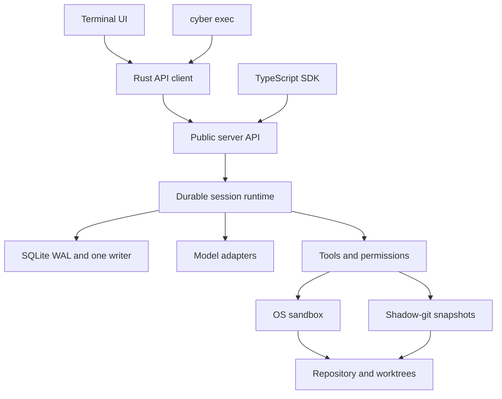
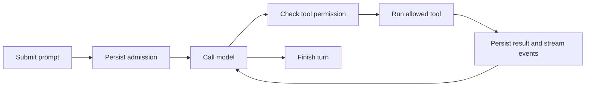

# Cyber Code (`cyber`)

A model-independent, local-first coding agent: a durable server owns your sessions and multi-agent workflows, and a terminal UI, `exec`, an SDK or another agent over MCP can drive it.

## Why Cyber Code

- **Any model, no account.** OpenAI, Anthropic or any OpenAI-compatible endpoint, including a local model server. No Cyber account; hosted models need their own provider credentials. The full local-model baseline is still open ([evaluation guide](eval/README.md)).
- **A server that survives a crash.** Prompts are persisted before they run, and execution state lives in SQLite. A restarted server recovers interrupted Sessions, and the TUI, SDK and MCP clients share the same Sessions.
- **Workflows that resume after `kill -9`.** Claude Code also has [script-driven workflows][C7] with `agent()`/`parallel()`/`pipeline()`. Cyber's differences: runs execute in the background server rather than inside a CLI process; after a server crash they replay durably (`cyber workflows resume --interrupted`); several runs share agent slots fairly with a run queue; and each run has budgets and model tiers that can point at any provider ([details](docs/local-core-guide.md#workflows-p2-m21)).
- **Other agents can drive whole Sessions.** `cyber mcp serve` lets Claude Code, Codex or another MCP client create, prompt, wait on and interrupt Cyber Sessions, with idempotent receipts and a Mode ceiling. `claude mcp serve` [exposes Claude Code's tools][C4], and Codex [removed its MCP server][X5]. Partial: 7 of the 10 tools ship, and messaging is not implemented yet.
- **Recovery and confinement.** Shadow-git snapshots restore files without overwriting your own edits. Commands run in an OS sandbox on macOS and Linux (Windows is incomplete).
- **Open contracts.** Behavior is specified as [OpenSpec requirements](openspec/specs) tagged by phase and validated in CI, and implementation evidence is published ([P1](docs/implementation/p1-status.md), [P2](docs/implementation/p2-status.md)).
- **A full terminal UI.** 18 themes with a live switcher, Markdown with highlighted code, a responsive sidebar, the `Ctrl+P` palette, a file explorer, a workflows monitor, and Usage/Stats tabs (also as `cyber stats`).

## Screenshots

Real captures of the TUI in a pseudo-terminal at 160×48, against a scripted local model (not live inference). [How they were made](docs/screenshots/README.md).

| Welcome screen | Transcript with docked sidebar |
|---|---|
|  |  |
| **`/workflows` monitor: three runs and one queued** | **Settings › Stats** |
|  |  |

## Start here

Requires **Rust 1.89+**. SQLite is bundled. On Linux, install **bubblewrap** for sandboxed commands (`apt install bubblewrap`).

```bash
cargo build --locked -p cyber-cli
export OPENAI_API_KEY="your-key"

./target/debug/cyber                              # terminal UI
./target/debug/cyber exec "fix the failing test"  # one task
./target/debug/cyber review main..HEAD            # read-only review with sorted findings
./target/debug/cyber --continue                   # resume the latest session
./target/debug/cyber workflows run fanout --wait  # run a saved Workflow; progress on stderr
./target/debug/cyber stats --models               # local usage stats
./target/debug/cyber doctor                       # check your setup
```

Let another agent drive Cyber Sessions over MCP:

```bash
claude mcp add cyber -- cyber mcp serve --client claude-code
```

Use `--model provider/model` to select a model. Remote MCP servers that need OAuth are signed in explicitly with `cyber mcp auth <server>`; `cyber` never opens a browser on its own. See the [local core guide](docs/local-core-guide.md) for configuration, [MCP serve](docs/local-core-guide.md#mcp-serve-partial-p1) for Codex and HTTP setup, and [remote MCP OAuth](docs/local-core-guide.md#remote-mcp-oauth).

## What it does

| Area | Today | Details |
|---|---|---|
| Coding | Read/search, edit files and notebook cells, run commands, web tools | [Features](docs/features.md) |
| Sessions | Durable admission, streaming, interrupt/resume, crash recovery, compaction | [Features](docs/features.md) |
| Safety | Workspace trust, permission rules, protected paths, credential masking, macOS/Linux sandbox | Windows enforcement partial |
| Recovery | Shadow-git snapshots, restore preserving user edits, backup and retention | Broader rewind UI pending |
| Workflows (P2) | QuickJS sandbox, `agent()`/`parallel()`/`pipeline()`, determinism guards, durable replay, budgets, model tiers, parallel runs with fair scheduling and a queue | [Guide](docs/local-core-guide.md#workflows-p2-m21); `ask()`, `exec --workflow` not yet |
| MCP client | stdio and remote servers, OAuth, resources, prompts, elicitation, roots | WebSocket not implemented |
| MCP serve | Other agents create, read, prompt and interrupt Sessions (7 of 10 tools) | Messaging not yet |
| Hooks | Command, HTTP, prompt and MCP-tool handlers; managed-only org policy | Plugin hooks pending |
| Skills | Bundled `/review`, `/batch`, `/simplify`, `/security-review`, `/customize-cyber`; remote sources; `cyber review` | Plugin skills pending |
| Instructions | `CYBER.md`, `AGENTS.md`, `CLAUDE.md`, `CONTEXT.md`; confined `@path` imports | [Guide](docs/local-core-guide.md#project-instructions-and-cybermd) |
| TUI | Themes, Markdown, sidebar, palette, explorer, Settings/Usage/Stats, recaps | Some Settings extras pending |
| Clients | TUI, `exec`, background service, HTTP/SSE/WebSocket/stdio API, TypeScript SDK | [SDK](sdk/typescript/README.md) |
| Partial P1 | Subagents/worktrees, cancellation, budgets, memory, LSP, formatting, migration previews | [P1 status](docs/implementation/p1-status.md) |

## How it compares

Checked **2026-10-17** against each product's official docs. This compares documented capabilities, not coding quality or speed. "Partial" means Cyber Code has working pieces with contracts or acceptance gates still open.

| Feature | Cyber Code | Claude Code | Codex CLI | OpenCode |
|---|---|---|---|---|
| Edit files and run commands | Yes | Yes [C1] | Yes [X1] | Yes [O1] |
| Model providers | OpenAI, Anthropic, OpenAI-compatible | Claude via Anthropic, Bedrock, Vertex, Foundry [C2] | OpenAI and custom providers [X2] | 75+ providers [O2] |
| Local models | Compatible endpoint; full baseline pending | Not established | Ollama / LM Studio via `--oss` [X2] | Ollama, LM Studio, llama.cpp [O2] |
| Terminal UI | Yes | Yes [C1] | Yes [X1] | Yes [O1] |
| Headless / exec | `cyber exec` | `claude -p` [C3] | `codex exec` [X3] | `opencode run` [O3] |
| Editor / desktop / web | Planned: web P1, IDE P3, desktop P4 | VS Code, JetBrains, desktop, web [C1] | IDE, app, web, cloud [X1] | Desktop, IDE [O1], web [O13] |
| Tool permissions | Yes; full auto mode partial | Yes [C5] | Yes [X4] | Yes [O4] |
| OS sandbox | macOS/Linux; Windows incomplete | macOS/Linux/WSL2; native Windows unsandboxed [C6] | macOS, Linux/WSL2, native Windows [X4] | Not established (permission rules only) [O4] |
| Subagents | Partial | Yes [C8] | Yes [X6] | Yes [O5] |
| Multi-agent workflows | JS scripts in a QuickJS sandbox, durable replay | JS dynamic workflows, `/workflows` view [C7] | Not established | Not established |
| Parallel runs | Run queue, fair slot sharing, independent pause/stop/resume | Background agents, agent view, several workflow runs [C9] | Parallel subagents [X6], cloud tasks [X1] | Parallel subagents [O5] |
| Durable resume after crash | Server recovers Sessions; workflows replay after `kill -9` | `--resume`; workflows resumable in-session or relaunched after `--resume` [C7] | `codex resume` [X3]; crash recovery not established | Not established |
| MCP client | stdio + remote, OAuth, resources, prompts, elicitation, roots | Local and remote, OAuth [C4] | stdio + HTTP, OAuth [X7] | Local and remote, OAuth [O6] |
| Acting as an MCP server | `cyber mcp serve`: drives Sessions (partial) | `claude mcp serve`: exposes tools over stdio [C4] | Removed; app server (JSON-RPC) instead [X5] | Not established; ACP server [O3] |
| Hooks | Command, HTTP, prompt, MCP tool; managed policy | Command, HTTP, MCP tool, prompt, agent; managed policy [C10] | Command, MCP tool; managed policy [X8] | Plugin event hooks [O7] |
| Skills / custom commands | Bundled skills, remote sources, user commands (partial) | Skills and plugins [C11] | Skills and plugins [X9] | Skills and commands [O8] |
| Project instruction files | `CYBER.md`, `AGENTS.md`, `CLAUDE.md`, `CONTEXT.md` | `CLAUDE.md`; reads `AGENTS.md` [C12] | `AGENTS.md` [X10] | `AGENTS.md`, `CLAUDE.md` fallback [O9] |
| Undo / checkpoints | Shadow-git snapshots preserving user edits | `/rewind` checkpoints [C13] | Git checkpoints recommended [X1] | `/undo`, `/redo` [O1] |
| Programmatic API / SDK | HTTP/SSE/WebSocket/stdio API, TS SDK | Agent SDK [C14] | Codex SDK, app server [X11][X12] | HTTP server and SDK [O10] |
| LSP | Navigation and edit feedback (partial) | Via plugins [C15] | Not established | Built in [O11] |
| Themes | 18 built-in, custom JSON, `NO_COLOR` | `/theme`, custom themes [C16] | `/theme` syntax themes [X13] | Built-in and custom JSON [O12] |
| Usage stats | Usage/Stats tabs, `cyber stats` | `/usage` with Stats tab [C16] | `/status` context and rate limits [X14] | `opencode stats` [O3] |

"Not established" means the cited docs do not establish support; it does not mean the feature is absent. These products have different defaults, platform limits and release channels. Our implementation limits are in the [feature reference](docs/features.md).

## Status

- **P0 (local core):** implemented; release gates remain open, including the full local-model baseline and the long coding task ([evidence](docs/measurements/p0-exit-evidence.md)).
- **P1 (table stakes):** in progress; no P1 milestone is fully accepted. Windows confinement, native MCP OAuth keyring acceptance, plugins, complete client controls, browser verification and migration remain ([status](docs/implementation/p1-status.md)).
- **P2 (autonomy):** the Workflow runtime (M2.1) and parallel runs are implemented and accepted end to end with the real binary; `ask()`, direct read-only tools, `exec --workflow` and Job integration remain ([evidence](docs/implementation/p2-status.md)). Goals, loops and teams come later.

See the [roadmap](ROADMAP.md) for P3 (connectivity, IDE clients) and P4.

## Architecture



The server owns execution, compaction and recovery. Clients use HTTP, SSE, WebSocket or stdio JSON-RPC. SQLite stores execution state; snapshots store file recovery data. Built with Rust, tokio, axum, rusqlite and ratatui. [Architecture details](docs/local-core-guide.md#architecture).



## Documentation and development

[Documentation index](docs/README.md) · [Feature reference](docs/features.md) · [Commands and configuration](docs/local-core-guide.md) · [Roadmap](ROADMAP.md) · [SDK](sdk/typescript/README.md) · [OpenAPI](sdk/openapi.json) · [Evaluations](eval/README.md) · [OpenSpec contracts](openspec/specs)

Run `just` to list tasks, `just build` to build and `just ci` for local checks. Platform builds run in [CI](.github/workflows/ci.yml). See the [development guide](docs/local-core-guide.md#build-and-development) for raw commands and the pinned specification validator.

[C1]: https://code.claude.com/docs/en/overview
[C2]: https://code.claude.com/docs/en/third-party-integrations
[C3]: https://code.claude.com/docs/en/headless
[C4]: https://code.claude.com/docs/en/mcp
[C5]: https://code.claude.com/docs/en/permissions
[C6]: https://code.claude.com/docs/en/sandboxing
[C7]: https://code.claude.com/docs/en/workflows
[C8]: https://code.claude.com/docs/en/sub-agents
[C9]: https://code.claude.com/docs/en/agents
[C10]: https://code.claude.com/docs/en/hooks
[C11]: https://code.claude.com/docs/en/skills
[C12]: https://code.claude.com/docs/en/memory
[C13]: https://code.claude.com/docs/en/checkpointing
[C14]: https://code.claude.com/docs/en/agent-sdk/overview
[C15]: https://code.claude.com/docs/en/discover-plugins
[C16]: https://code.claude.com/docs/en/commands
[X1]: https://learn.chatgpt.com/docs/codex/cli
[X2]: https://learn.chatgpt.com/docs/config-file/config-reference
[X3]: https://learn.chatgpt.com/docs/non-interactive-mode
[X4]: https://learn.chatgpt.com/docs/sandboxing
[X5]: https://learn.chatgpt.com/docs/mcp-server
[X6]: https://learn.chatgpt.com/docs/agent-configuration/subagents
[X7]: https://learn.chatgpt.com/docs/extend/mcp
[X8]: https://learn.chatgpt.com/docs/hooks
[X9]: https://learn.chatgpt.com/docs/skills-and-plugins
[X10]: https://learn.chatgpt.com/docs/agent-configuration/agents-md
[X11]: https://learn.chatgpt.com/docs/codex-sdk
[X12]: https://learn.chatgpt.com/docs/app-server
[X13]: https://learn.chatgpt.com/docs/cli-customization
[X14]: https://learn.chatgpt.com/docs/reference/slash-commands
[O1]: https://opencode.ai/docs/
[O2]: https://opencode.ai/docs/providers/
[O3]: https://opencode.ai/docs/cli/
[O4]: https://opencode.ai/docs/permissions/
[O5]: https://opencode.ai/docs/agents/
[O6]: https://opencode.ai/docs/mcp-servers/
[O7]: https://opencode.ai/docs/plugins/
[O8]: https://opencode.ai/docs/skills/
[O9]: https://opencode.ai/docs/rules/
[O10]: https://opencode.ai/docs/server/
[O11]: https://opencode.ai/docs/lsp/
[O12]: https://opencode.ai/docs/themes/
[O13]: https://opencode.ai/docs/web/
