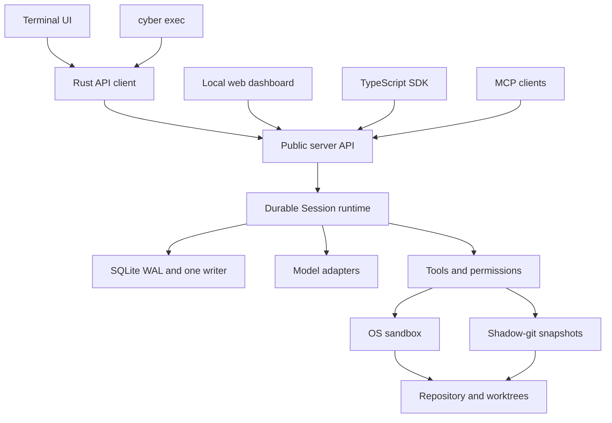
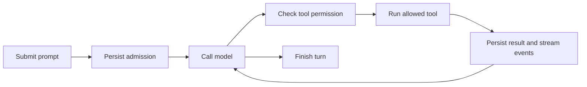

# Architecture

Cyber Code runs one background server per user. Clients share its Sessions, permissions, scheduling and execution state. Closing a client does not stop the server's work.

The server owns execution, compaction and recovery. Clients use HTTP, SSE, WebSocket or stdio JSON-RPC. SQLite records execution state; shadow-git snapshots provide file recovery. The browser bundle is embedded in the Rust binary and uses authenticated public APIs.

Built with Rust, tokio, axum, rusqlite and ratatui, with TypeScript for the browser client and SDK. See the [server lifecycle guide](local-core-guide.md#background-server-and-rebuilds), [storage decision](decisions/0001-storage-architecture.md) and [dashboard security/access guide](web-dashboard.md).
