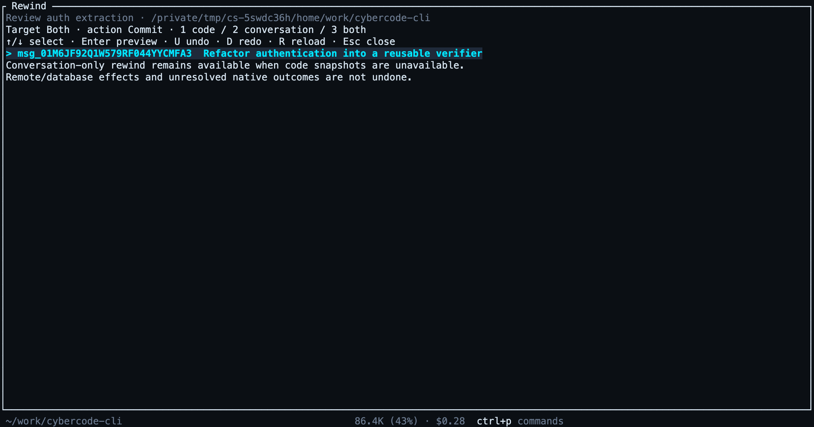
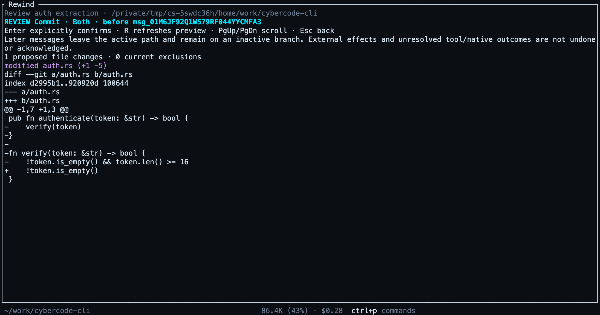

# Reviewed rewind

`cyber sessions rewind` previews a rewind before applying it. It does not start
inference or interrupt a busy Session automatically. An existing staged revert
must be explicitly committed or cleared before starting this reviewed flow.

```sh
cyber sessions rewind ses_example --to msg_example --target both
# Review the proposed patches, exclusions and effect disclosure, then:
cyber sessions rewind ses_example --to msg_example --target both --confirm <fingerprint>
```

Use `--format json` for the typed preview/result. `--to` takes an exact active
user-message ID; Session selection accepts the usual ID, title or unique prefix.
Every target requires explicit confirmation. `code` restores eligible files and
keeps the conversation; `conversation` moves the active path before that message;
`both` does both. Later conversation messages remain reachable through
`cyber sessions tree`, checkout and `export --all-branches`.

The fingerprint binds the Session, exact Location, sequence, boundary, active tip,
snapshot identities, proposed patches, available current/historical exclusions and retained tool status.
A changed context requires a fresh review. Code planning uses
three-way merge rules; unrelated owner files stay intact and are not shown as
proposed deletions. Conflicts are reported before application. Git planning uses a separate shadow index; file-copy planning uses private objects.
Neither installs proposed files into the workspace.

Confirmation obtains native Location ownership, rechecks the current tree under
the workspace mutation lock and refreshes admission before file changes. A failed
native acknowledgement or event commit after a possible effect retains the native
activity fence and backup evidence; it is not a successful rewind. Do not repeat a
mutation to infer its outcome. Inspect the Session and retained recovery evidence.

Code rewind uses shadow Git snapshots in repositories. On Linux/macOS, an
admitted non-Git Location uses private BLAKE3 file-copy snapshots. The filesystem
must expose stable directory creation identity and support native metadata and
replacement operations; restore currently needs the Location and Cyber data on
the same filesystem. Unsupported cases refuse code restore visibly. Windows
currently supports Git snapshots and conversation-only rewind outside Git.
Disabled snapshots also retain conversation-only rewind.

Current exclusions are listed, and previews disclose target/recorded exclusion
history. New Git snapshots bind their exclusion inventory and exact Location into
an immutable annotated-tree record; equal file trees with different omissions have
different snapshot identities. Legacy bare trees remain readable and explicitly
report unavailable exclusion history. Recorded/current omissions never authorize
a deletion or restore. New Git tree/record references are retained together until
reference-aware reclamation is available. Legacy stages keep their original owner-route behavior. A
reviewed file stage cannot be replaced or cleared through legacy stage/clear
routes, or discarded by branch checkout; use a reviewed clear or explicitly
commit it.

Owner routes, under the normal authenticated server boundary:

- `POST /api/v1/sessions/{id}/rewind/preview` with `message_id`, `target`,
  `expected_directory` and optional `action` (`commit`, the default; `stage`;
  `clear`) returns the preview and `confirmation` fingerprint.
- `POST /api/v1/sessions/{id}/rewind/confirm` takes those selection fields plus the
  reviewed fingerprint. No client-supplied snapshot identity is trusted.

The response is limited to 4 MiB. This bounds the response, not peak Git planning
memory. The TypeScript SDK exposes both generated operations. Fingerprints are
review identities, not authentication credentials. Rewind does not undo remote
calls, sent messages or unknown tool/native outcomes and does not guarantee atomic
replacement against arbitrary external writers.

## Terminal menu and undo/redo

Open `/rewind`, or press Esc twice within 500 ms while idle. Select an active
user-message boundary, choose `1` code, `2` conversation or `3` both, and press
Enter to preview. Enter again explicitly commits the reviewed rewind. This menu
preserves the current composer. Scroll the review with arrows or PgUp/PgDn.
`/rewind`, `/undo` and `/redo` are built-ins in the shared command catalog,
available through slash completion and `GET /commands`.



The review shows the actual proposed patches, snapshot exclusions, retained tool
statuses and external-effect warning before confirmation.



`/undo` reviews a staged rewind to the latest user boundary. Confirm to restore
eligible files and copy the boundary's plain prompt text into the composer.
Repeated `/undo` moves backward; `/redo` reviews movement forward. The final
`/redo` reviews clearing the stage and restoring the original baseline. Each
transition needs a fresh review and explicit confirmation. The staged boundary
commits on the next prompt, shell command or compaction; the header shows
`UNDO STAGED` until then. The target stays fixed during a staged chain.

Opening rewind while busy does not interrupt work. Press `I` to request
interruption, then `R` to refresh if the server has not yet acknowledged idle.
Normal busy Esc still interrupts; permission/question prompts and the native
emergency stop retain priority. No rewind starts inference.

Composer replacement requires an acknowledged operation for the exact Session,
Location and panel generation, with no intervening composer edit or attachment.
Newer text stays intact. The original plain-text draft is retained in memory for
up to 32 Session/Location pairs; `P` in the menu copies a retained original. Clear
restores it only while the composer still matches the last restored prompt.
Undo/redo refuses unsent attachment chips; historical media attachments are not
recreated. After a TUI restart, retained server stages remain available but the
original in-memory draft is unavailable, so clear preserves the current composer.

Reviewed file stages durably retain the original baseline, selected agent snapshot
and union of paths actually changed (maximum 4096). Clear only restores that path
set through the existing three-way planner; unrelated owner files are not adopted
into redo authority. Old stages without this manifest use their original clear
route. After an ambiguous response, the panel drops its preview: `R` reads current
status, without automatically replaying the mutation or replacing the composer.

The screenshots are real terminal captures against a local scripted provider.
The capture fixture writes the sample edit during a held Turn to exercise actual
Git snapshots and preview rendering; it does not confirm the rewind.

This implements the CLI, TUI and SDK rewind surfaces, the file-copy backend and
managed recovery of [#93](https://github.com/CyberdyneCorp/cybercode-cli/issues/93)
on Linux and macOS. The native proof workflow runs the capture, restore, recovery,
reclamation, storage-privacy and process-death cases on Linux x64/ARM and macOS
Intel/ARM. Known limits: Windows has no non-Git snapshots or native managed
recovery; managed Git source recovery is off in release builds (see
[Recovering an interrupted restore from the CLI](#recovering-an-interrupted-restore-from-the-cli));
legacy restore intents and bare Git trees keep the limits described below; and
device nodes are not exercised, because creating one needs privileges.

## Recovery acceptance coverage

The real-binary regression suite kills the fixture-owned service after an
acknowledged code/combined stage, reloads its durable state, restages, kills it
again and clears through a fresh review. It checks the original baseline,
changed-path ownership, owner edits, stale-review refusal and no new inference.
Conversation-only stages are also exercised after service loss with no Git and
with snapshots disabled; continuing preserves the inactive branch for export.
Busy confirmation and post-interruption stale review are refused through the CLI.
A fresh TUI App separately verifies that clear preserves a new terminal's draft.

An instrumented snapshot-port test loses native acknowledgement, reloads the
runtime and checks that subtree stop reports retained unknown evidence, keeps
admission closed and does not replay restoration. This is not a native
partial-replacement crash test. The file-copy suite additionally kills a real
worker between native file replacements, then verifies retained preimages, an incomplete journal and refusal
to replay. Real-binary cases also kill the service at debug-only fixture points:
after origin and before intent publication, after the intent and before staging,
directly after a progress record (for an ordinary rewind, a staged undo beside an
inactive branch, and inside a keep/rollback), after filesystem completion with
displaced images, after the paired recovery writer commit, and after a journal
acknowledgement whose reply was never sent. Payload-cleanup kills and the same
cuts in a managed Git worktree (`native-git-acceptance` builds) complete the
matrix; all of them run on Linux x64/ARM and macOS Intel/ARM in
`non-git-snapshot-proof.yml`. Release-build Git restore does not use this journal.

Snapshot storage is owner-only through the real binary: after capture and after a
reviewed restore, every directory under `<data>/snapshot/global` is mode `0700`
with no macOS ACL entry, every object, manifest, journal record and lock is
private and singly linked, and a displaced source image keeps its own mode only
below those private directories. A source file's recorded mode is restored
unchanged. Storage widened by someone else is refused: code rewind reports it
`not private`, nothing new is written there, and conversation work and
conversation-only rewind continue.

## Non-Git storage and retained restore intents

File-copy snapshots live under
`<data>/snapshot/global/<Location identity>/`: immutable BLAKE3 objects in `files`,
versioned Location-bound manifests in `manifests`, and native restore evidence in
`journals`. The Location identity binds the canonical directory, native device/
inode and creation time. Replacing a directory or using a foreign snapshot cannot
transfer restore authority. Capture hashes bytes every time; matching size and
mtime never establish content identity.

Capture respects `.gitignore`, `.cyberignore` and `snapshots.ignore`; configured
ignores cannot be undone by a project whitelist. Private owner roots and `.git`,
`.cyber` and `.claude` directories are excluded. Symlinks, hardlinks, read-only
files, non-plain ACL/extended metadata and unsupported objects are skipped. Snapshot exclusions are retained in each manifest so omitted
files are not falsely described as deletions. When an unsupported object (a FIFO,
socket, device, link or hard-linked file) now occupies a path the restore would
change, review and restore report that path as a conflict and refuse the whole
restore; the object is never opened, deleted or replaced. File modes appear in review. Existing
ownership is preserved; recreating a deleted file uses its recorded ordinary ownership/mode or refuses before publishing it.
Missing parents are created privately. Non-plain metadata is excluded until it can
be retained and recreated safely.

`snapshots.max_file_bytes` defaults to 2 MiB (hard per-file bound 64 MiB),
`snapshots.fallback_max_bytes` to 200 MiB per Location, and
`snapshots.retention_days` to seven days. Limits account for retained logical
payloads, records and displaced preimages; filesystem allocation overhead differs.
A cap warning is emitted once per Location/condition in the running service;
conversation work and successful `exec` results continue. A fresh capture retries
availability after conditions change. Durable Session references protect staged
baselines and inactive branches. Unreferenced old manifests/objects can be pruned
only with a complete durable reference view. Namespaces containing journals remain
protected from manifest/object pruning; no quota or timeout discards unresolved
evidence.

On admitted Linux/macOS hosts, periodic maintenance can reclaim displaced regular
file payloads from an ordinary, completed and natively acknowledged file-copy
restore in an unmanaged Location. It requires the exact durable restore receipt,
exited worker proof, a complete reference view and the retention period measured
from durable settlement. Disabled snapshots or zero retention preserve payloads.
Live readers, independent unknown effects, changed payloads or incomplete native
ownership refuse cleanup. A full capture may attempt the same eligible cleanup
and retry once. Cleanup retains the intent, lifetime records and durable retry
receipt, and never reads or restores source files.

Acknowledged keep/rollback recovery can also reclaim its original and resolution
regular-file stages together under both exited worker lifetimes. It requires the
exact paired receipt, both native acknowledgements, the original settlement link
and unchanged recorded private slots. Both inventories are checked before deletion;
interrupted cleanup resumes only through its durable plan. Both intents and lookup
receipts remain usable afterward. Legacy restores without cleanup ownership proof
are never reclaimed, and managed Git payload reclamation is not enabled in release
builds. Construction evidence is removed only through the owner-only discard
described below.

Cancelled pre-effect preparations can reclaim fully prepared regular target images
after retention when their recorded inode identities and committed intent proof
still match. Cleanup preserves the intent and cancellation records and permits
later receipt acknowledgement without reading or restoring source files. Older
cancellations lacking committed intent proof and incomplete constructions remain
protected; their payloads are not inferred from filenames or matching bytes.

Before file changes, restore durably publishes an intent and prepares private
stages. Replacements retain displaced inodes; progress and completion are flushed
independently. Admission and content/route identities are rechecked. A failure or
process loss leaves the journal and preimages intact and blocks later file-copy
capture/restore in that Location. It does not automatically roll back, retry or
acknowledge uncertain native effects.

Inspect retained evidence through the normal authenticated owner API:

```sh
cyber api GET /sessions/<session-id>/rewind/recovery
```

`GET /api/v1/sessions/{id}/rewind/recovery` and SDK
`client.session.snapshotRecovery(sessionID)` list the selected Session's
Location journals. Inspection is bounded and read-only, remains available while a
native writer is paused, and does not create an absent namespace or start
inference. `filesystem_complete` means only that the worker flushed its final
filesystem record; it does not acknowledge the Session/native receipt. `applied`
contains durable checkpoints; a missing entry is not proof of no effect.

When the Session's Location directory has been removed, the listing does not fail.
Each retained journal recorded for that path is listed from its own record with
`location_removed: true`: it is orphaned and read-only. It cannot be reviewed,
restored or acknowledged, and listing locks, creates or deletes nothing. A journal
is attributed to the removed Location only when its recorded path matches and its
namespace key is the digest of that path and the recorded directory identity.
`cyber sessions recovery` marks such rows `Location removed (orphaned, read-only)`
and the TUI recovery panel shows `Location removed: read-only, not restorable` and
does not open request discovery for them.

Reviewed non-Git restores retain their actual worker ownership after a client
disconnects. New input is refused while that worker is active or has unresolved
effects; Stop and read-only inspection remain available between source changes.
On success, Session changes and the exact worker acknowledgement commit together,
followed by acknowledgement of the retained journal. A completed filesystem
record without that acknowledgement still blocks another restore. Legacy journals
remain readable without acquiring new authority to acknowledge native effects.
The snapshot-worker compatibility migration makes older binaries open this
database read-only; they cannot safely enforce the new admission fences.

New version-3 file-copy journals record original/staged file identities and parent
identities before source changes. Missing parents are prepared privately and their
identities recorded before publication. This evidence distinguishes a completed
rename from a later same-byte owner replacement even when progress was not saved.
The journal bound includes this metadata; at most 4096 distinct parent paths are
prepared for one restore. Older intents do not gain historical file ownership
evidence from matching content. Read-only native inspection never captures new
objects or changes owner files. Created-parent permissions and other metadata are
checked against preparation; existing owner-directory modes are preserved.

Read-only recovery review is available through the owner API:

```sh
cyber api POST /sessions/<session-id>/rewind/recovery/review \
  -d '{"journal_id":"restore_...","action":"rollback"}'
```

Use `"keep"` to review preserving the current files. SDK callers can use
`client.session.snapshotRecoveryReview(sessionID, { journal_id, action })`.
Review reports recorded before/after images, current and retained private images,
proposed changes, recorded created parents and retained exclusions. Missing
exclusion history is explicit. A foreign replacement cannot become a rollback
target merely because its bytes match. Live or already acknowledged activities,
foreign Sessions and unavailable native proof prohibit confirmation. Review does
not start inference, restore files, move the conversation or acknowledge activity.
The bounded review is limited to 16 MiB; the simpler journal catalog remains 4 MiB.

New origins bind the exact private lock inode. A replacement lock file cannot
prove an old worker has exited; older origins without this proof stay inspectable
and fenced. Retained file-copy evidence remains inspectable when capture is
disabled or capture limits are lowered. Resolution writes still obey the cap.

Confirm a reviewed keep/rollback using its exact fingerprint and a retained request ID:

```sh
cyber api POST /sessions/<session-id>/rewind/recovery/confirm \
  -d '{"journal_id":"restore_...","action":"rollback","confirmation":"<fingerprint>","request_id":"<unique-request-id>"}'
cyber api GET /sessions/<session-id>/rewind/recovery/requests/<request-id>
```

A repeated confirmation looks up that original request, including an incomplete
outcome; it never runs the file changes again. Changed request content refuses.
Lookup does not inspect native files, so `journal_acknowledged: null` means that
response has not observed the journal acknowledgement. For an already committed
recovery receipt, POST its `/acknowledge` child to reconcile only missing journal
acknowledgements. Ordinary successful file-copy rewinds use GET
`/sessions/<session-id>/rewind/restores/<activity-id>` and POST its `/acknowledge`
child. These operations preserve later files, including unsupported replacements,
and do not move the transcript. Historical receipts without immutable proof cannot
authorize new journal writes.

If a crash occurred before source effects were admitted, list the retained
preparation candidates and review the selected activity:

```sh
cyber api GET /sessions/<session-id>/rewind/preparations
cyber api POST /sessions/<session-id>/rewind/preparations/<activity-id>/review
cyber api POST /sessions/<session-id>/rewind/preparations/<activity-id>/confirm \
  -d '{"confirmation":"<fingerprint>","request_id":"<unique-cancellation-id>"}'
cyber api GET /sessions/<session-id>/rewind/preparations/<activity-id>/requests/<request-id>
```

The SDK exposes `snapshotPreparations`, `snapshotPreparationReview`,
`snapshotPreparationConfirm`, `snapshotPreparationLookup` and
`snapshotPreparationAcknowledge` on `client.session`. Listing reads no source files
or native records; for a managed checkout it adds only the names of retained checkout
construction stages for that activity (`checkout_constructions`), which grant no
authority. Review determines eligibility. Review requires the exact retained lifetime
lock proving that this worker exited and a version-2 native phase record proving
that source effects were never admitted. A published origin is eligible only when
the database also positively records no source admission. Missing journal files
alone grant no authority. An older database backup cannot override an admitted
native phase. Live workers, changed proof, legacy reservations and admitted source
effects refuse cancellation.

Confirmation cancels only that preparation: source files and transcript remain
unchanged. Its paired durable receipt precedes native cancellation metadata; the
original intent is retained without fabricating a completed restore. Retry and
lookup return the original durable pair without reopening native proof. After a
committed receipt with missing native acknowledgement, POST
`/sessions/<session-id>/rewind/preparations/<activity-id>/requests/<request-id>/acknowledge`
to reconcile metadata under the exact proof. This never replays source changes.
A receipt with a complete acquired checkout binding can reconcile only that
preparation's exact exited checkout claims. Independent checkout and process
uncertainty remains fenced. Cancelling an unstarted keep/rollback request leaves its original failed restore unresolved; its lookup
reports `cancelled_before_origin` or `cancelled_before_effects`.

Created source directories, private payloads, native phase records and lifetime
preparations remain protected for acknowledged safe cleanup. Do not edit records
or remove evidence to force a retry. Release builds do not journal owned Git
restores, and an interrupted checkout-claim acquisition stays fenced as described
under [Interrupted checkout construction](#interrupted-checkout-construction).


Managed checkout snapshots use an independent claim named by the snapshot's native
activity, so they do not reuse a Session, binary document, MCP or language-server
claim. The native claim remains locked through worker settlement. Hosts without
explicit support refuse managed snapshot admission. A crash while acquiring a claim
can still leave unknown checkout evidence. When the complete acquired set was
published before checkout settlement, its committed preparation receipt can
acknowledge those exact claims while retaining their original bytes. Missing or
incomplete publication and legacy claims keep their fences; retain that evidence
for the remaining recovery path.


While a managed snapshot is running, the worker verifies its pinned checkout claim
and worktree creation metadata before source changes and consuming commits. Aliased
or replaced claim files, changed creation contents and replaced activity directories
refuse. These checks preserve evidence. New checkout acknowledgement also requires
the exact committed preparation receipt and complete acquired-resource binding;
verification alone cannot clear an unknown claim.


New Linux/macOS lifetime-bound checkout claims publish their complete native record
before becoming visible under the activity name. A pre-publication crash retains a
construction record and prevents reuse of that activity. Runtime validates Session
creation, directory, lifetime digest and the whole returned resource set, then
persists that set before settling checkout admission. Construction evidence is retained for the pending safe
recovery/cleanup path; it cannot be removed to force a retry. Windows does not yet
admit the lifetime-bound durability path.

Native preparation acknowledgement publishes separate metadata after the consuming
commit. It never rewrites an original checkout claim or clears another Session's
unknown activity. If acknowledgement is interrupted, look up the committed request
and use its explicit acknowledgement endpoint; confirming again only returns the
receipt. Existing native journal or checkout receipts must match before a new
consuming commit, so a database backup cannot replace a different native receipt.
An authorized later worktree removal retains referenced creation metadata for
retry/recreation. Payloads, construction records and archived creation evidence
remain protected until reference-aware cleanup is implemented.

Git restore resolves file paths literally and verifies each blob image against its
Git object ID. Corrupt blob data or ambiguous image listings refuse before source
replacement. Retain the snapshot data for diagnosis; this check does not provide
the still-unfinished owned Git crash-recovery workflow.


Recovery image views distinguish `kind: "file"` from `kind: "symlink"`; a missing
kind means file, including in legacy responses. A link image's hash and byte length describe
the link target text, not the contents of its target file. Native recovery never
follows that target while staging, exchanging or reading retained preimages.
The local Git journal bridge supports typed native link fixtures, but ordinary
owned Git recovery remains unavailable until its remaining lifecycle, full-state
and platform acceptance gates are complete.


## Recovering an interrupted restore from the CLI

List retained journals, then review an exact journal and action:

```sh
cyber sessions recovery ses_example
cyber sessions recovery ses_example restore_example --action keep
cyber sessions recovery ses_example restore_example --action rollback --format json
```

Review does not change files or move the conversation. Text quotes paths and request IDs, escaping terminal controls without collapsing
distinct names. It shows original worker identity,
current/before/after/retained/proposed images, historical exclusions,
protected created parents, conflicts and acknowledgement status. Unavailable
historical evidence is shown explicitly. `keep` preserves the reviewed live files;
`rollback` reverses only effects proven to belong to that restore. Neither resumes
the failed rewind or undoes external tool effects. Conflicted or unverifiable
reviews have no confirmation fingerprint.

Apply only a reviewed fingerprint, using a request ID you retain:

```sh
cyber sessions recovery ses_example restore_example --action rollback \
  --confirm <review-fingerprint> --request-id recovery-one
```

Malformed fingerprints and incomplete option combinations fail before service
startup. Request IDs contain 1–256 bytes without NUL; the CLI also refuses exact
`.` and `..`, which URL clients normalize as path segments. Other spaces, slashes
and URL punctuation are encoded without changing the request identity. Quote such
IDs in your shell. For a lookup ID beginning with `-`, use
`recovery-request <session> -- <request-id>` so it is parsed as an ID.

If interrupted or unsure whether the reply arrived, look up the same request:

```sh
cyber sessions recovery-request ses_example recovery-one
cyber sessions recovery-request ses_example recovery-one --format json
```

Lookup reads the durable request without replaying files. Repeating the original
confirmation with the same request ID and identical content also performs lookup;
changed content refuses. Never choose a new ID to retry an uncertain outcome.
A successful lookup can report a pending or unknown outcome; inspect `state`.
Runtime `acknowledged` and native journal acknowledgement are separate fields.
`journal_acknowledged: null` means this lookup has not observed native metadata,
not that the metadata is absent. To explicitly reconcile an acknowledged durable
request whose native acknowledgement was interrupted:

```sh
cyber sessions recovery-request ses_example recovery-one --acknowledge
```

This verifies the exact retained worker/checkout receipts and writes only native
acknowledgement metadata; it does not reinstall source files or change the
conversation. Metadata that is already acknowledged is left untouched, so repeating
the command writes nothing. Cleanup after `keep` deletes a retained private image
only when it is the restore's own recorded original or target; any other inode
(for example an owner file that raced the interrupted restore) refuses cleanup and
keeps its bytes. Confirmation/reconciliation exits 1 if the returned state does not
establish the requested acknowledgement. Lookup itself can return an unresolved
state with exit 0 because the read succeeded. Both commands support `--format json`.

If the keep/rollback itself is interrupted (for example the service dies between
its file exchanges), its resolution journal (`restore_resolution_...`) is listed as
a separate journal next to the original. The interrupted request stays `pending`;
repeating it never resumes or replays it. Review and confirm keep or rollback for
the resolution journal first. The interrupted request then reports
`resolved_by_another_request`, and the original journal still needs its own review
and a new request ID before new input is admitted:

```sh
cyber sessions recovery ses_example restore_resolution_example --action keep
cyber sessions recovery ses_example restore_resolution_example --action keep \
  --confirm <fingerprint> --request-id resolution-keep
cyber sessions recovery ses_example restore_example --action keep
cyber sessions recovery ses_example restore_example --action keep \
  --confirm <fingerprint> --request-id original-keep
```

These commands expose the implemented managed file-copy recovery path on admitted
Linux/macOS hosts. Ordinary managed Git source recovery remains disabled by default
(owner decision 2026-11-15): it stays off until the native CI matrix is green and
will then be an explicit opt-in. Today only the `native-git-acceptance` test build
admits it; no configuration key enables it in a release build. File-copy journal
reclamation is described in
[Non-Git storage and retained restore intents](#non-git-storage-and-retained-restore-intents);
native results come from the proof workflow on Linux x64/ARM and macOS Intel/ARM.

## Recovery in the terminal panel

Open `/rewind` (or idle Esc-Esc) and press **C** to inspect recovery. This entry
also remains available when code rewind reports unavailable or conflicting state.
Select a journal with Up/Down, then Enter to discover its retained requests.

- If there are no requests, **K** reviews keep and **B** reviews rollback. The
  review shows original worker identity, images, historical exclusions, protected
  created parents and conflicts. A second Enter confirms its fingerprint.
- If requests already exist, select one and press Enter to look it up. A fresh
  terminal uses these server-retained identities after a lost reply; it does not
  choose another request ID to replay the operation.
- **R** refreshes the current read/review. After confirmation or an ambiguous
  response it performs exact request lookup. Enter never retries source work from
  an outcome view.
- An acknowledged runtime result may still have unobserved native acknowledgement.
  **A** explicitly reconciles that request's native metadata without reinstalling
  source files. A positively cancelled pre-effect attempt, or an attempt resolved by another
  owned request, offers K/B for a fresh review of the original restore;
  pending/unknown outcomes retain their fences.
- PgUp/PgDn scroll; Esc closes. Closing does not cancel an already admitted native
  worker. Reopen recovery to discover its retained request.

Recovery preserves the composer, attachments and conversation. Replies from an old
Session, Location or UI generation are ignored. Missing legacy proof never enables
confirmation, and failed request discovery cannot license a fresh attempt.
Press **P** in recovery to inspect pre-effect preparations, including committed
cancellations. Select a candidate and press Enter: the panel first discovers an
existing cancellation receipt; otherwise it requests a fresh pre-effect review.
Only a matching current review offers Enter to cancel. The panel retains the
request identity before sending confirmation. After an ambiguous reply, **R**
looks up that same request; Enter cannot repeat cancellation. **A** explicitly
reconciles a committed receipt's native metadata. **J** returns to journals.
A receipt alone does not establish observed native acknowledgement. Preparation
cancellation preserves independent restore, process and checkout uncertainty.

The panel uses the opt-in read
`GET /api/v1/sessions/{id}/rewind/preparations?include_cancelled=true` and exact
receipt discovery at `/rewind/preparations/{activity_id}/receipt`. Default listing
continues to return pending candidates. History is scoped to the current Session
creation; discovery validates the committed receipt pair and does not touch
source files or perform native reconciliation. An absent receipt grants no
cancellation authority: native proof must still pass review and confirmation.
Managed Git preparations exist only in `native-git-acceptance` builds.

`GET /api/v1/sessions/{id}/rewind/recovery/requests?journal_id=restore_example`
provides the read-only discovery used by the panel. It requires an exact journal,
filters to the current Session creation, verifies request-owner identities and
returns at most 4096 retained confirmation records. Overflow refuses explicitly
without deleting history. Discovery does not inspect source files, acknowledge
native work or start inference. The SDK exposes `session.snapshotRecoveryRequests`.

## Recovering an exited pre-effect preparation

A worker can stop before it publishes an intent or admits source effects. Its
missing journal alone does not prove that cancellation is safe. List retained
candidates and review an exact activity:

```sh
cyber sessions recovery-preparation ses_example
cyber sessions recovery-preparation ses_example op_example
```

Listing shows durable status and whether lifetime metadata exists; it does not
establish that the worker exited. Review acquires the exact retained native
lifetime/checkout evidence and refuses a live worker, missing historical proof,
stale ownership or possible admitted effects. It shows the published-origin flag,
versions/sequences, complete checkout-set digest when available and the protocol
warning. Nothing is cancelled by review.

### Interrupted checkout construction

A managed restore first writes its checkout claim to a private, flushed stage and
then publishes it under its stable name without replacement. If the process dies
between the two, the stage stays behind as same-owner unknown constructor evidence:
no claim exists, and the Session refuses new input ("Snapshot worker outcome
requires owned recovery before new input"). `cyber sessions recovery <session>`
points to the unresolved preparation, and `recovery-preparation` lists the stage
under its activity (JSON `checkout_constructions`); the TUI recovery panel (**C**,
then **P**) shows the same line. Cancelling that pre-effect preparation restores
prompt admission. The stage itself is fenced by design: it is never adopted as a
claim, nothing deletes it automatically, and removing the worktree refuses with a
`same-owner unknown constructor` error naming it. An interrupted acknowledgement
stage behaves the same way for metadata retirement. Only the owner's explicit
discard (below) removes construction evidence; do not delete the stage by hand.

Recovery clients show a checkout stage under the preparation whose activity owns
it while that preparation is unresolved. Every stage, including one whose
preparation was cancelled, a cancellation-record stage and one with a malformed
name, is listed by `cyber sessions recovery-discard <session>` (and in the text of
`cyber sessions recovery` and the TUI recovery panel, with the exact discard
command). The preparation listing's name inventory is advisory: if it cannot be
read, the listing still returns its preparations without stage names.

### Discarding construction evidence (local owner only)

A construction stage is a private file a constructor flushed but never published: a
checkout claim stage (`preparing_*`), a checkout acknowledgement stage
(`ack_preparing_*`) or a file-copy cancellation-record stage (`tmp_*` beside a
journal's `preparation.json`). The local owner can discard exactly one reviewed stage
per confirmation:

```sh
cyber sessions recovery-discard ses_example
cyber sessions recovery-discard ses_example preparing_10_op_example_01J...
cyber sessions recovery-discard ses_example preparing_10_op_example_01J... \
  --confirm <review-fingerprint> --request-id discard-one
cyber sessions recovery-discard-request ses_example discard-one
```

The first command lists the stages (kind, owner activity, Location state) and every
`discard pending` request; `--activity <op>` reviews the only stage of an activity.
Review is read-only: it reports the stage's kind, owner activity, device and inode,
size, modification time, SHA-256 (stages over 1 MiB, links and special files are
refused), the operations it fences and whether the Location is present or removed,
plus a fingerprint over all of that and the Session revision.

Confirmation refuses, leaving every stage, journal and record unchanged, when:

- the fingerprint is stale (the stage or the Session changed since review);
- the Session is not idle, has background work or an admitted snapshot worker, or
  still has an unresolved snapshot preparation (cancel it first);
- the stage's constructor lock or the activity's snapshot lifetime lock is still
  held (`busy:`), or the snapshot namespace is busy;
- the stage name has no derivable owner, or its owner is not a snapshot activity of
  the Session;
- a claim stage's activity already published a claim; an acknowledgement stage's
  claim has no `.snapshot-ack` published from another stage yet, or a
  cancellation-record stage's journal has no `preparation.json` yet (run
  `recovery-preparation-request --acknowledge` once first);
- the caller is not the authenticated local owner (`403`): a bearer or peer
  identity, a peer attachment, a browser, an MCP client label or a model tool;
- the Session is a managed checkout whose Location was removed.

Restore journals, payload images and every published claim, acknowledgement and
cancellation record are never discarded by this command, and it never removes the
worktree. Once the last stage is gone, worktree removal and metadata retirement are
admitted again.

A confirmed discard first records a `session.snapshot.construction_discarded.1`
intent in the Session's history, then moves the stage with a no-replace rename into
a private `discarded/<key>/` directory of the same namespace, flushes it and unlinks
it there; the receipt is completed last. Every step re-checks the reviewed identity:
a file that differs is reported (`changed`) and never deleted. Repeating the
confirmation with the same request ID resumes an interrupted discard or returns the
receipt; `recovery-discard-request` (or
`GET .../rewind/constructions/discard/requests/<request-id>`) only reads it. A stage
that was moved but not unlinked is `discard pending`: maintenance retries the unlink
a minute after start and then hourly without a time limit, `cyber doctor` and the
recovery listings report it, and file-copy stages count toward the snapshot storage
cap until removed. Receipts are never removed by retention.

The API equivalents are `GET /sessions/<id>/rewind/constructions`,
`POST /sessions/<id>/rewind/constructions/discard/review` (`{"stage": ...}` or
`{"activity_id": ...}`), `POST .../discard/confirm`
(`{"stage", "confirmation", "request_id"}`) and
`GET .../discard/requests/<request-id>`; the SDK exposes `constructionInventory`,
`constructionDiscardReview`, `constructionDiscardConfirm` and
`constructionDiscardLookup` on `client.session`. The TUI only shows the command in
this revision.

Confirm only a reviewed fingerprint and retain your stable cancellation ID:

```sh
cyber sessions recovery-preparation ses_example op_example \\
  --confirm <review-fingerprint> --request-id cancel-one
cyber sessions recovery-preparation-request ses_example op_example cancel-one
cyber sessions recovery-preparation-request ses_example op_example cancel-one --acknowledge
```

The second command looks up the exact committed cancellation without replay; the
third explicitly reconciles that receipt's native metadata. Repeating the original
confirmation with the same request ID/content also returns its retained receipt.
A receipt lookup does not establish observation of native acknowledgement. Errors
after confirmation include the exact lookup command, with quoted IDs. Never choose
a new request ID to retry an uncertain outcome. All forms support `--format json`;
malformed/incomplete confirmation options fail before service startup.

Cancellation preserves files, transcript, retained intents, private payloads and
independent process/checkout uncertainty. Older receipts can remain inspectable
without gaining newer native acknowledgement authority. If source effects may
have been admitted, use the journal's keep/rollback review instead. No force-clear
option exists; construction stages are discarded only as described above.
