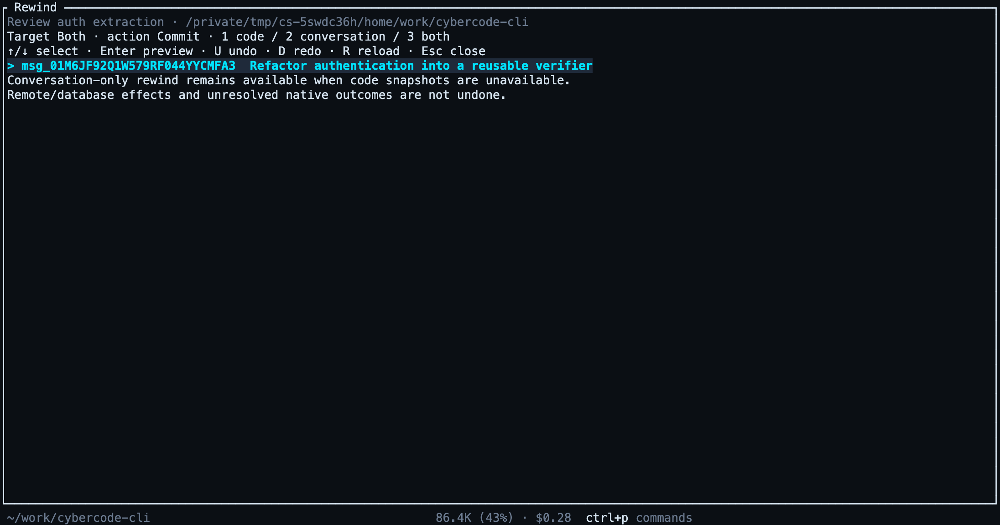
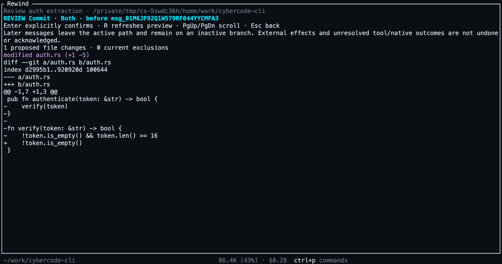

# Reviewed rewind

`cyber sessions rewind` previews a rewind before applying it. It does not start
inference or interrupt a busy Session automatically. An existing staged revert
must be explicitly committed or cleared before starting this reviewed flow.

```sh
cyber sessions rewind ses_example --to msg_example --target both
# Review the proposed patches, exclusions and effect disclosure, then:
cyber sessions rewind ses_example --to msg_example --target both --confirm <fingerprint>
```

Use `--format json` for the typed preview/result. `--to` takes an exact active
user-message ID; Session selection accepts the usual ID, title or unique prefix.
Every target requires explicit confirmation. `code` restores eligible files and
keeps the conversation; `conversation` moves the active path before that message;
`both` does both. Later conversation messages remain reachable through
`cyber sessions tree`, checkout and `export --all-branches`.

The fingerprint binds the Session, exact Location, sequence, boundary, active tip,
snapshot identities, proposed patches, available current/historical exclusions and retained tool status.
A changed context requires a fresh review. Code planning uses
three-way merge rules; unrelated owner files stay intact and are not shown as
proposed deletions. Conflicts are reported before application. Git planning uses a separate shadow index; file-copy planning uses private objects.
Neither installs proposed files into the workspace.

Confirmation obtains native Location ownership, rechecks the current tree under
the workspace mutation lock and refreshes admission before file changes. A failed
native acknowledgement or event commit after a possible effect retains the native
activity fence and backup evidence; it is not a successful rewind. Do not repeat a
mutation to infer its outcome. Inspect the Session and retained recovery evidence.

Code rewind uses shadow Git snapshots in repositories. On Linux/macOS, an
admitted non-Git Location uses private BLAKE3 file-copy snapshots. The filesystem
must expose stable directory creation identity and support native metadata and
replacement operations; restore currently needs the Location and Cyber data on
the same filesystem. Unsupported cases refuse code restore visibly. Windows
currently supports Git snapshots and conversation-only rewind outside Git.
Disabled snapshots also retain conversation-only rewind.

Current exclusions are listed, and previews disclose target/recorded exclusion
history. New Git snapshots bind their exclusion inventory and exact Location into
an immutable annotated-tree record; equal file trees with different omissions have
different snapshot identities. Legacy bare trees remain readable and explicitly
report unavailable exclusion history. Recorded/current omissions never authorize
a deletion or restore. New Git tree/record references are retained together until
reference-aware reclamation is available. Legacy stages keep their original owner-route behavior. A
reviewed file stage cannot be replaced or cleared through legacy stage/clear
routes, or discarded by branch checkout; use a reviewed clear or explicitly
commit it.

Owner routes, under the normal authenticated server boundary:

- `POST /api/v1/sessions/{id}/rewind/preview` with `message_id`, `target`,
  `expected_directory` and optional `action` (`commit`, the default; `stage`;
  `clear`) returns the preview and `confirmation` fingerprint.
- `POST /api/v1/sessions/{id}/rewind/confirm` takes those selection fields plus the
  reviewed fingerprint. No client-supplied snapshot identity is trusted.

The response is limited to 4 MiB. This bounds the response, not peak Git planning
memory. The TypeScript SDK exposes both generated operations. Fingerprints are
review identities, not authentication credentials. Rewind does not undo remote
calls, sent messages or unknown tool/native outcomes and does not guarantee atomic
replacement against arbitrary external writers.

## Terminal menu and undo/redo

Open `/rewind`, or press Esc twice within 500 ms while idle. Select an active
user-message boundary, choose `1` code, `2` conversation or `3` both, and press
Enter to preview. Enter again explicitly commits the reviewed rewind. This menu
preserves the current composer. Scroll the review with arrows or PgUp/PgDn.
`/rewind`, `/undo` and `/redo` are built-ins in the shared command catalog,
available through slash completion and `GET /commands`.



The review shows the actual proposed patches, snapshot exclusions, retained tool
statuses and external-effect warning before confirmation.



`/undo` reviews a staged rewind to the latest user boundary. Confirm to restore
eligible files and copy the boundary's plain prompt text into the composer.
Repeated `/undo` moves backward; `/redo` reviews movement forward. The final
`/redo` reviews clearing the stage and restoring the original baseline. Each
transition needs a fresh review and explicit confirmation. The staged boundary
commits on the next prompt, shell command or compaction; the header shows
`UNDO STAGED` until then. The target stays fixed during a staged chain.

Opening rewind while busy does not interrupt work. Press `I` to request
interruption, then `R` to refresh if the server has not yet acknowledged idle.
Normal busy Esc still interrupts; permission/question prompts and the native
emergency stop retain priority. No rewind starts inference.

Composer replacement requires an acknowledged operation for the exact Session,
Location and panel generation, with no intervening composer edit or attachment.
Newer text stays intact. The original plain-text draft is retained in memory for
up to 32 Session/Location pairs; `P` in the menu copies a retained original. Clear
restores it only while the composer still matches the last restored prompt.
Undo/redo refuses unsent attachment chips; historical media attachments are not
recreated. After a TUI restart, retained server stages remain available but the
original in-memory draft is unavailable, so clear preserves the current composer.

Reviewed file stages durably retain the original baseline, selected agent snapshot
and union of paths actually changed (maximum 4096). Clear only restores that path
set through the existing three-way planner; unrelated owner files are not adopted
into redo authority. Old stages without this manifest use their original clear
route. After an ambiguous response, the panel drops its preview: `R` reads current
status, without automatically replaying the mutation or replacing the composer.

The screenshots are real terminal captures against a local scripted provider.
The capture fixture writes the sample edit during a held Turn to exercise actual
Git snapshots and preview rendering; it does not confirm the rewind.

This implements the CLI and TUI rewind surfaces and the initial file-copy backend
of [#93](https://github.com/CyberdyneCorp/cybercode-cli/issues/93). Managed recovery
resolution, journal reclamation, legacy historical-exclusion limits and broader
native acceptance remain open. Path rules/context, root structured output and
JSONL input are also outstanding.

## Recovery acceptance coverage

The real-binary regression suite kills the fixture-owned service after an
acknowledged code/combined stage, reloads its durable state, restages, kills it
again and clears through a fresh review. It checks the original baseline,
changed-path ownership, owner edits, stale-review refusal and no new inference.
Conversation-only stages are also exercised after service loss with no Git and
with snapshots disabled; continuing preserves the inactive branch for export.
Busy confirmation and post-interruption stale review are refused through the CLI.
A fresh TUI App separately verifies that clear preserves a new terminal's draft.

An instrumented snapshot-port test loses native acknowledgement, reloads the
runtime and checks that subtree stop reports retained unknown evidence, keeps
admission closed and does not replay restoration. This is not a native
partial-replacement crash test. The file-copy suite additionally kills a real
worker between native file replacements, then verifies retained preimages, an incomplete journal and refusal
to replay. Broader cut-point/metadata/platform acceptance and managed resolution
remain required. Git restore has not gained this new journal.

## Non-Git storage and retained restore intents

File-copy snapshots live under
`<data>/snapshot/global/<Location identity>/`: immutable BLAKE3 objects in `files`,
versioned Location-bound manifests in `manifests`, and native restore evidence in
`journals`. The Location identity binds the canonical directory, native device/
inode and creation time. Replacing a directory or using a foreign snapshot cannot
transfer restore authority. Capture hashes bytes every time; matching size and
mtime never establish content identity.

Capture respects `.gitignore`, `.cyberignore` and `snapshots.ignore`; configured
ignores cannot be undone by a project whitelist. Private owner roots and `.git`,
`.cyber` and `.claude` directories are excluded. Symlinks, hardlinks, read-only
files, non-plain ACL/extended metadata and unsupported objects are skipped. Snapshot exclusions are retained in each manifest so omitted
files are not falsely described as deletions. File modes appear in review. Existing
ownership is preserved; recreating a deleted file uses its recorded ordinary ownership/mode or refuses before publishing it.
Missing parents are created privately. Non-plain metadata is excluded until it can
be retained and recreated safely.

`snapshots.max_file_bytes` defaults to 2 MiB (hard per-file bound 64 MiB),
`snapshots.fallback_max_bytes` to 200 MiB per Location, and
`snapshots.retention_days` to seven days. Limits account for retained logical
payloads, records and displaced preimages; filesystem allocation overhead differs.
A cap warning is emitted once per Location/condition in the running service;
conversation work and successful `exec` results continue. A fresh capture retries
availability after conditions change. Durable Session references protect staged
baselines and inactive branches. Unreferenced old manifests/objects can be pruned
only with a complete durable reference view. Every namespace containing journals
is conservatively retained; no quota or timeout discards unresolved evidence.

Before file changes, restore durably publishes an intent and prepares private
stages. Replacements retain displaced inodes; progress and completion are flushed
independently. Admission and content/route identities are rechecked. A failure or
process loss leaves the journal and preimages intact and blocks later file-copy
capture/restore in that Location. It does not automatically roll back, retry or
acknowledge uncertain native effects.

Inspect retained evidence through the normal authenticated owner API:

```sh
cyber api GET /sessions/<session-id>/rewind/recovery
```

`GET /api/v1/sessions/{id}/rewind/recovery` and SDK
`client.session.snapshotRecovery(sessionID)` list the selected Session's
Location journals. Inspection is bounded and read-only, remains available while a
native writer is paused, and does not create an absent namespace or start
inference. `filesystem_complete` means only that the worker flushed its final
filesystem record; it does not acknowledge the Session/native receipt. `applied`
contains durable checkpoints; a missing entry is not proof of no effect.

Reviewed non-Git restores retain their actual worker ownership after a client
disconnects. New input is refused while that worker is active or has unresolved
effects; Stop and read-only inspection remain available between source changes.
On success, Session changes and the exact worker acknowledgement commit together,
followed by acknowledgement of the retained journal. A completed filesystem
record without that acknowledgement still blocks another restore. Legacy journals
remain readable without acquiring new authority to acknowledge native effects.
The snapshot-worker compatibility migration makes older binaries open this
database read-only; they cannot safely enforce the new admission fences.

New version-3 file-copy journals record original/staged file identities and parent
identities before source changes. Missing parents are prepared privately and their
identities recorded before publication. This evidence distinguishes a completed
rename from a later same-byte owner replacement even when progress was not saved.
The journal bound includes this metadata; at most 4096 distinct parent paths are
prepared for one restore. Older intents do not gain historical file ownership
evidence from matching content. Read-only native inspection never captures new
objects or changes owner files. Created-parent permissions and other metadata are
checked against preparation; existing owner-directory modes are preserved.

Managed keep/rollback resolution, lost-reply acknowledgement reconciliation and
reclamation of retained journals are not implemented yet. Do not edit records or
remove evidence to force a retry. Complete operator recovery and broader native
crash/platform acceptance remain unfinished.
