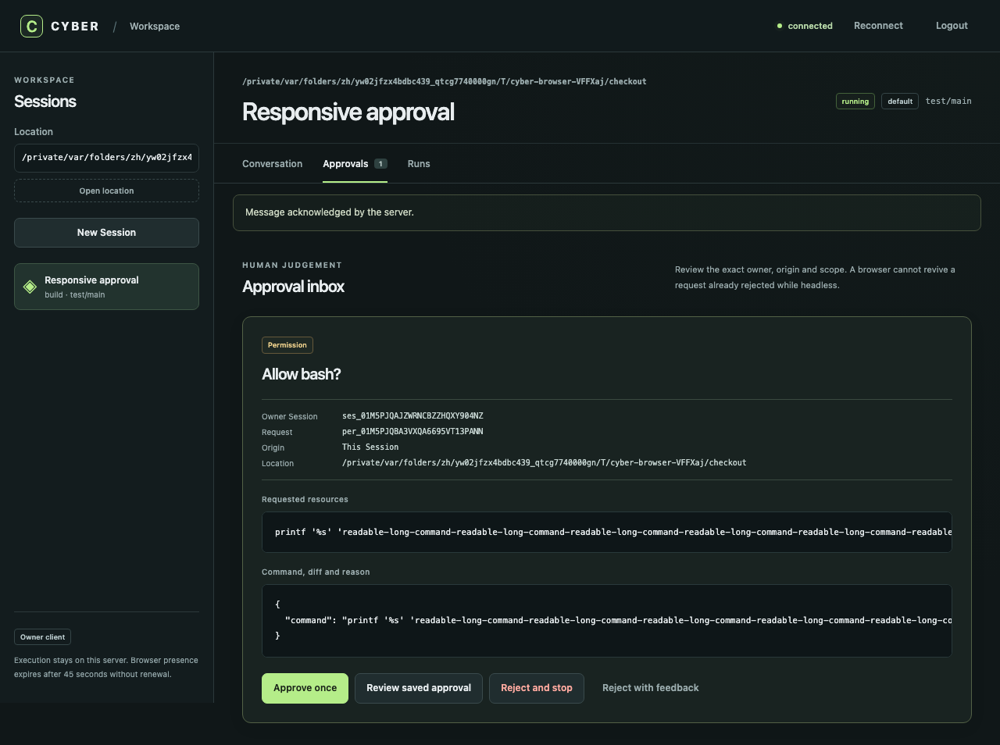

# Local web dashboard

The dashboard runs in the same `cyber` server as the terminal client. It provides Session navigation, transcripts, prompts and an approval inbox, plus the existing workflow, Job and Goal controls. This is the first P1 browser slice; full Settings, attachments, terminal emulation, Relay and paired Devices are outside this delivery.

## Start and sign in

```sh
cyber web
# Or print the URL without opening a browser:
cyber web --no-open
# Retrieve the password in your terminal:
cyber service password
```

Open the printed URL and enter the password. The username is `cyber`; the page sends explicit Basic authorization headers. **This is the local owner's password:** it grants owner API authority, rather than a limited team membership or Device grant. Give it only to someone trusted to control that server.

Credentials live only in the open page's memory. Reloading, logging out or an authentication failure requires signing in again. No password belongs in a URL, bookmark, browser storage, cookie or source file. The public page and bundled assets contain no Session data; all data requests and replies use authenticated APIs. There is no Node runtime requirement in the distributed CLI.

`cyber web` reuses a healthy registered server. `--hostname` and `--port` configure a new listener; if a healthy server already uses different settings, the command refuses the change. Finish active work and run `cyber service stop` before launching the desired settings. It never silently exposes or replaces an active listener. A server from another build that cannot safely be replaced also requires an explicit stop.

## Access from another computer

For an SSH connection, keep the server on loopback and forward its actual printed port. For example, if it prints port 4747:

```sh
# On the server:
cyber web --no-open --hostname 127.0.0.1 --port 4747
# On your other computer (replace the SSH destination):
ssh -N -L 4747:127.0.0.1:4747 user@your-server
```

Open `http://127.0.0.1:4747/` on that computer. If a different local port is free, use it on the left of `-L`. Cyber does not create the tunnel or open router ports.

For a LAN or VPN connection, configure an operator-managed certificate and private key in the **global** `cyber.jsonc`, using absolute paths:

```jsonc
{
  "server": {
    "tls": {
      "cert": "/absolute/path/to/fullchain.pem",
      "key": "/absolute/path/to/private-key.pem"
    }
  }
}
```

On Windows, use absolute paths such as `C:/Users/you/certs/fullchain.pem`. Protect the private key with OS permissions. Use a certificate trusted by each client and valid for the hostname clients will open. A private CA must be installed on those clients. Cyber does not bypass certificate verification or provision a certificate service.

```sh
cyber web --no-open --hostname dashboard.your-private-domain.example --port 4747
```

The hostname must resolve to an address on this server. You can instead bind `0.0.0.0` or `::` to listen on all interfaces, then manually open the certificate's actual hostname from the other computer. A wildcard bind registers a loopback URL for local clients; include that loopback IP in the certificate SANs as well as the remote hostname. Otherwise use the certificate hostname as `--hostname`, so the browser and local CLI/TUI use a verifiable registered URL. Off-loopback plaintext listeners are refused; there is no `--insecure-lan`. Restart the service after changing TLS settings or certificate files. Existing origin restrictions remain enforced; the dashboard does not add wildcard CORS.

The separate peer listener does not serve the dashboard and does not accept the owner password. Cyber Account and project-hub membership are separate features and do not authenticate this owner dashboard.

## Approval and disconnect behavior

The owner-authenticated lease APIs are `POST /api/v1/sessions/{sessionID}/interactive-clients`, and `PUT`/`DELETE /api/v1/sessions/{sessionID}/interactive-clients/{clientID}`. Create and renew return `{ "data": { "client_id", "session_id", "expires_at" } }`, with `expires_at` in Unix milliseconds; release returns 204. Use the same Location and an idempotency key for each logical mutation. Replaying an expired receipt never recreates presence; an unknown or expired renewal returns 404.

Selecting a Session establishes a browser-presence lease, renewed every 15 seconds and expiring after 45 seconds without renewal. Presence permits asking an attached human; it does not grant tool permissions or relax Mode, sandbox, Location or saved-rule policy. Requests from child Sessions keep their original owner identity.

A reply is applied only after the server acknowledges it. A pending or uncertain decision stays bound to the original Session, request and idempotency key. Another browser or terminal may answer first; a stale card must never approve a later request. Review the displayed scope before an `always` decision.

The page displays connection state and disables stale actions during recovery. It reconnects with bounded backoff, resumes durable events and refetches pending requests and live status. A server restart invalidates leases and requires signing in and attaching again. When the last browser presence disappears, pending and future asks follow ordinary unattended policy; they are never approved automatically. Other live browser or terminal clients retain their presence, and unrelated executing tools are not cancelled by lease expiry.

## Browser views

The approval inbox displays the original Session, request, Location and command, with separate one-time, saved-scope and rejection actions. Screenshots below come from the real CLI and a scripted local provider, using fixture data.



[View the 360-pixel mobile approval inbox](screenshots/web-dashboard-mobile.png). Long commands scroll within the card.

## Development and acceptance

The TypeScript package lives in `web/`. Its committed `dist/` files are embedded in the Rust binary. After changing browser sources, regenerate them with `npm run build`; CI checks reproducibility, types, unit tests and real-browser acceptance against the actual CLI and a scripted provider.

```sh
cd web
npm ci
npm run build
npm run typecheck
npm test
npx playwright install chromium
npm run test:e2e
```

Build `cargo build -p cyber-cli` first; the browser fixture uses that binary. Browser evidence and platform limitations are recorded in [dashboard implementation evidence](implementation/web-dashboard.md). Physical second-device acceptance must be recorded separately from headless browser or local-forward testing.
